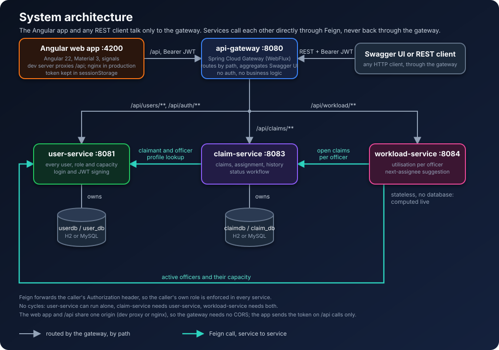
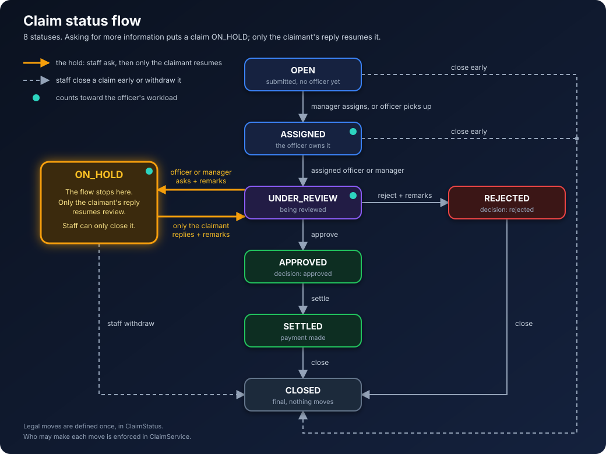

# Chubb APAC – Backend Claim Management

A microservices-based claims platform for filing, assigning and tracking insurance claims across six APAC markets, built
with **Java 21** and **Spring Boot 3.3**.


## Architecture



The gateway reaches the services at fixed URLs (the `services.*.url` properties).

| Module             | Port | Responsibility                                                         | Database          |
|--------------------|------|------------------------------------------------------------------------|-------------------|
| `api-gateway`      | 8080 | Single entry point, routing, aggregated Swagger UI                     | –                 |
| `user-service`     | 8081 | **All users** (claimants, officers, managers): profiles, roles, capacity, active flag, login and JWT issuing | `userdb` / `user_db` |
| `claim-service`    | 8083 | Claims, assignment, status workflow, history                           | `claimdb` / `claim_db`       |
| `workload-service` | 8084 | Utilisation per officer, next-assignee suggestion                      | stateless (computed live) |
| `common`           | –    | Shared library: security, exception handling, Feign auth, OpenAPI      | –                 |

Each service owns its own database (database-per-service). Cross-service data is fetched through **OpenFeign**
(`claim-service → user-service`, `workload-service → user-service / claim-service`).
There is deliberately **one** service for every kind of user: a `users` table holds identity, password hash and role, and
the role decides which profile fields apply (claimants: market, policy number; officers: specialization, max capacity).

### Security

* **JWT bearer authentication** (Spring Security resource server) with **role-based** method security
  (`@PreAuthorize`). Log in once with `POST /api/auth/login` (username + password) to receive an HS256-signed token
  (default lifetime 120 minutes) carrying the username and roles, then send `Authorization: Bearer <token>` on every call.
  The gateway forwards the header and Feign calls propagate it, so the original caller's identity and role is enforced in
  every service. Services validate the token locally with the shared secret; only `user-service` ever sees a password
  (stored as a BCrypt hash; disabled users cannot log in).
* Configure the signing secret with `CHUBB_SECURITY_JWT_SECRET` (**same value in every service**, at least 32 characters;
  the built-in default is for local demos only) and the lifetime with `chubb.security.jwt.expiration-minutes`.
* Demo users are created in the `users` table on first start (`chubb.seed-demo-users`, set to `false` in production).
  The user id is what other services store (a claim's `claimantId`, its `assignedOfficerId`):

| Username    | Password      | Role       | Linked record                     |
|-------------|---------------|------------|-----------------------------------|
| `claimant1` | `claimant123` | CLAIMANT   | user id 1 (Aiko Tanaka, market JP) |
| `claimant2` | `claimant123` | CLAIMANT   | user id 2 (Wei Lim, market SG)    |
| `officer1`  | `officer123`  | OFFICER    | user id 3 (Priya Nair, cap. 5)    |
| `officer2`  | `officer123`  | OFFICER    | user id 4 (Daniel Chen, cap. 8)   |
| `manager1`  | `manager123`  | MANAGER    | user id 5 (Maria Santos)          |
| `claimant3` | `claimant123` | CLAIMANT   | user id 6 (Mei Chen, market HK)   |
| `claimant4` | `claimant123` | CLAIMANT   | user id 7 (Somchai Prasert, market TH) |
| `claimant5` | `claimant123` | CLAIMANT   | user id 8 (Arjun Mehta, market IN) |
| `claimant6` | `claimant123` | CLAIMANT   | user id 9 (Budi Santoso, market ID) |

**Demo claims.** `claim-service` also seeds 14 claims on first start (`chubb.seed-demo-claims`, set to `false` wherever the
demo users are off): a MOTOR and a PROPERTY claim in each of the six markets, plus a HEALTH claim (JP) and a TRAVEL claim
(SG), spread over every status from `OPEN` to `CLOSED` with their history. Log in, then `GET /api/claims` (as a manager or
officer) shows them all, and `?market=HK&claimType=PROPERTY` narrows them down.

> The in-memory user store is deliberately simple for this exercise. For production, replace the lookup in
> `AuthService` in `user-service` with an identity-provider backed implementation (the users table already
> stores hashed passwords and an active flag).

### Access matrix

| Endpoint                                   | CLAIMANT         | OFFICER                        | MANAGER |
|--------------------------------------------|------------------|--------------------------------|---------|
| `POST /api/claims`                         | own claim        | on behalf of claimant          | ✔       |
| `GET /api/claims`, `/{id}`, `/{id}/history`| own claims only  | all                            | all     |
| `PUT /api/claims/{id}/assignment`          | ✖                | ✖                              | ✔       |
| `PATCH /api/claims/{id}/status`            | own claim, only to answer an information request | only claims assigned to them | ✔ |
| `POST /api/auth/login`                     | ✔ (public)       | ✔ (public)                     | ✔ (public) |
| `GET /api/users/me`, `/api/users/{id}`     | own profile only | any user                       | any user |
| `GET /api/users?role=&active=`             | ✖                | ✔                              | ✔       |
| `POST /api/users`                          | ✖                | claimants only                 | any role |
| `PUT / DELETE /api/users/{id}`             | ✖                | ✖                              | ✔       |
| `GET /api/workload`, `/{officerId}`       | ✖                | ✔                              | ✔       |
| `GET /api/workload/suggestion`             | ✖                | ✖                              | ✔       |

## Business rules

**Claim status workflow** (`ClaimStatus`):



An officer or manager can ask the claimant for more information while a claim is under review. The claim is then
`ON_HOLD`: the flow stops until the claimant submits the information, and after that the officer or manager processes it
as usual.

* Any other transition returns **409 Conflict** listing the allowed next statuses.
* `ASSIGNED` can only be reached through the assignment endpoint; rejecting a claim requires `remarks`.
* **Asking for more information**: `PATCH /api/claims/{id}/status` with `{"status":"ON_HOLD","remarks":"what is needed"}`
  (assigned officer or manager, only from `UNDER_REVIEW`; remarks are mandatory). The claim then shows `infoRequest`
  (`message`, `requestedBy`, `requestedAt`), so the claimant sees what to provide.
* **Providing it**: the claimant calls the same endpoint, `PATCH /api/claims/{id}/status`, with
  `{"status":"UNDER_REVIEW","remarks":"<the reply>"}` (remarks up to 500 characters and mandatory, **409** if blank). It only
  works on their own claim (**403** otherwise) and only while the claim is `ON_HOLD` (**409** otherwise); a claimant
  asking for any other status gets **403**. The claim goes straight back to `UNDER_REVIEW`, the reply is kept as `lastReply`
  (`message`, `repliedBy`, `repliedAt`) and both steps appear in the history (`INFO_REQUESTED`, `INFO_PROVIDED`). The officer
  or manager then approves or rejects as usual.
* **On hold until the claimant answers**: while a claim is `ON_HOLD` the flow stops. The officer and the manager
  cannot move it to `UNDER_REVIEW`, approve, reject or settle it (**409** "Claim is on hold"); only the claimant's reply
  resumes review. Staff can still close it (for example when the claimant never replies) and a manager can still reassign it.
* Assignment verifies the officer exists and is active, is not already the assignee, and has spare
  capacity (`open claims < maxCapacity`). Reassigning keeps the current status.
* **Markets**: `SG`, `HK`, `JP`, `TH`, `IN`, `ID`. Every claimant has one (required when registering a claimant).
  `POST /api/claims` requires `claimantName` and `market` in the body, and both must match the claimant (the name ignoring
  case and spaces), otherwise **409**, so a claimant cannot file into another market. A claimant with no market also gets
  **409**. The claim stores the claimant's name and market as they were when it was filed, and every claim returned shows
  `claimantName`, `market` and `claimantId`. Filter with
  `GET /api/claims?market=SG&claimType=PROPERTY` (both optional, combinable with `status`, `claimantId` and
  `assignedOfficerId`); an unknown market or type returns **400**.
* **History**: every creation, assignment/reassignment, status change, information request and reply is appended to `claim_history`
  (who, when, from → to, remarks). `GET /api/claims/{id}/history` also shows each entry's `claimId`, `claimantName` and
  `market`.
* **Status update response**: `PATCH /api/claims/{id}/status` returns the updated claim with all its usual fields, plus
  `previousStatus` (the status before the request), and the `remarks`, `changedBy` and `changedAt` of the change. When an
  officer's update also picks up an `OPEN` claim, `previousStatus` is `OPEN` and the history lists the `ASSIGNED` step too.
* **Workload**: open claims = claims in `ASSIGNED`, `UNDER_REVIEW` or `ON_HOLD` (the officer still owns a claim that
  has asked the claimant for more information).
  `utilization % = open / maxCapacity × 100`; level `LOW` (<50), `MODERATE` (<80), `HIGH` (<100), `FULL` (≥100).

## Prerequisites

* JDK 21 (`java -version`)
* Internet access on first build (Maven downloads dependencies). No local Maven needed – use `mvnw`.
* Optional: MySQL 8 for the `mysql` profile.

## Build & test

```powershell
.\mvnw.cmd clean install        # Windows   (./mvnw clean install on Linux/macOS)
```

JUnit 5 / Mockito tests run as part of the build (service logic, workflow rules, JPA repositories on H2,
controller security & validation via `@WebMvcTest`).

## Run

**One command (Windows):**

```powershell
.\scripts\start-all.ps1                 # H2 in-memory
.\scripts\start-all.ps1 -Profile mysql  # MySQL
```

**Manually** – start in this order, each in its own terminal, from the repo root:

```bash
./mvnw -q -DskipTests install
java -jar user-service/target/user-service-1.0.0.jar
java -jar claim-service/target/claim-service-1.0.0.jar
java -jar workload-service/target/workload-service-1.0.0.jar
java -jar api-gateway/target/api-gateway-1.0.0.jar
```

Or `./mvnw -pl <module> spring-boot:run`.

Check http://localhost:8080/api/workload (log in as manager1) – a 200 means the gateway, workload, user and claim services are all reachable.

### Using MySQL instead of H2

H2 (in-memory, MySQL compatibility mode) is the default and needs no setup; the demo users are seeded
on start-up. To use MySQL run `user-service` and `claim-service` with `--spring.profiles.active=mysql`.
Databases `user_db` and `claim_db` are created automatically; override the connection with
environment variables `DB_URL`, `DB_USERNAME`, `DB_PASSWORD` (defaults: `jdbc:mysql://localhost:3306/<db>`,
`root` / `root`). Tables are generated from the JPA entities; demo users and demo claims are only seeded into empty tables.
H2 consoles are available at `http://localhost:808{1,3}/h2-console` (JDBC URL `jdbc:h2:mem:<userdb|claimdb>`, user `sa`).

## API documentation (Swagger UI)

* **Aggregated, via the gateway:** http://localhost:8080/swagger-ui.html.
  1. Pick **user-service** in the top-right dropdown, run `POST /api/auth/login` with a demo user and copy the `accessToken`.
  2. Click **Authorize**, paste the token (no `Bearer ` prefix), click **Authorize** then **Close**.
  3. Switch to any other service in the dropdown and use **Try it out**; the token is remembered across reloads
     until it expires (then log in again).
* Per service: http://localhost:8081/swagger-ui.html (user), `:8083` (claim), `:8084` (workload).

## Example walkthrough (through the gateway)

```bash
# 0. log in as each user (the response contains "accessToken"; here extracted with sed, or use jq -r .accessToken)
login() { curl -s -H "Content-Type: application/json" -X POST http://localhost:8080/api/auth/login \
  -d "{\"username\":\"$1\",\"password\":\"$2\"}" | sed -E 's/.*"accessToken":"([^"]+)".*/\1/'; }
CLAIMANT=$(login claimant1 claimant123); MANAGER=$(login manager1 manager123); OFFICER2=$(login officer2 officer123)

# 1. claimant files a claim (claimant id is taken from the logged-in user; name and market must match their profile)
curl -H "Authorization: Bearer $CLAIMANT" -H "Content-Type: application/json" -X POST http://localhost:8080/api/claims \
  -d '{"claimantName":"Aiko Tanaka","market":"JP","claimType":"MOTOR","description":"Rear-ended at lights","claimAmount":1500.00,"incidentDate":"2026-10-01"}'

# 2. manager asks which officer has capacity, then assigns the claim
curl -H "Authorization: Bearer $MANAGER" http://localhost:8080/api/workload/suggestion
curl -H "Authorization: Bearer $MANAGER" -H "Content-Type: application/json" -X PUT http://localhost:8080/api/claims/1/assignment \
  -d '{"officerId":4}'      # 4 = officer2 (Daniel Chen), a user id

# 3. the assigned officer works the claim
curl -H "Authorization: Bearer $OFFICER2" -H "Content-Type: application/json" -X PATCH http://localhost:8080/api/claims/1/status \
  -d '{"status":"UNDER_REVIEW","remarks":"Reviewing documents"}'
curl -H "Authorization: Bearer $OFFICER2" -H "Content-Type: application/json" -X PATCH http://localhost:8080/api/claims/1/status \
  -d '{"status":"APPROVED"}'

# 4. audit trail and workload
curl -H "Authorization: Bearer $CLAIMANT" http://localhost:8080/api/claims/1/history
curl -H "Authorization: Bearer $MANAGER" http://localhost:8080/api/workload
```

Errors share one JSON shape (`timestamp`, `status`, `error`, `message`, `path`, `details[]`):

| Situation                                   | Status |
|---------------------------------------------|--------|
| Bean-validation failure / malformed JSON    | 400 (field errors in `details`) |
| No, invalid or expired token / bad login    | 401    |
| Role or ownership violation                 | 403    |
| Unknown claim / claimant / officer            | 404    |
| Illegal status transition, capacity, duplicates | 409 |
| Downstream service failure                  | 502 (or the downstream 4xx) |

## Project layout

```
claims-management-system/
├── pom.xml                 parent POM (Boot 3.3.5, Spring Cloud 2023.0.3, modules)
├── common/                 shared auto-configuration (JWT validation, exception handler, Feign, OpenAPI)
├── api-gateway/
├── user-service/           all users: controller → service → JPA repository, entity/User, login + token signing
├── claim-service/          + client/ (Feign), entity/ (Claim, ClaimHistory), model/ClaimStatus workflow
├── workload-service/       + client/ (Feign), stateless calculation
└── scripts/start-all.ps1
```

## Troubleshooting

* **`JAVA_HOME` not defined / wrong Java** – Maven needs a JDK 21 (`$env:JAVA_HOME = "C:\Program Files\Java\jdk-21"`).
* **502 / connection refused from a service** – the downstream service is not started yet (or runs on another port). Service URLs default to `localhost:8081-8084`; override with `services.user.url`, `services.claim.url`, `services.workload.url`.
* **Port already in use** – change `server.port` in the service's `application.yml`.
