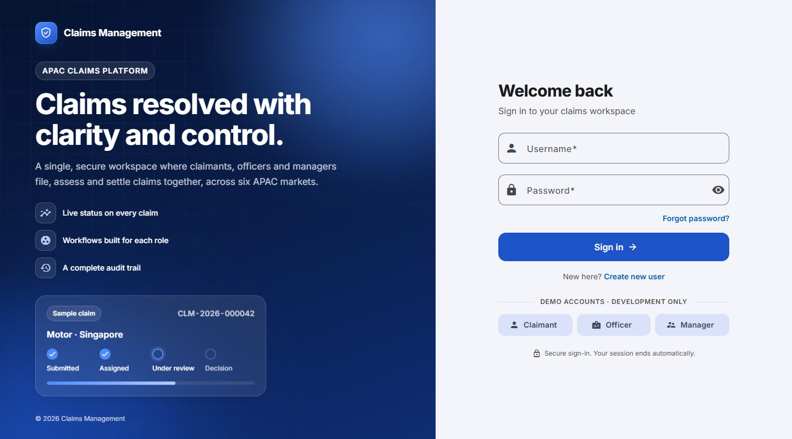
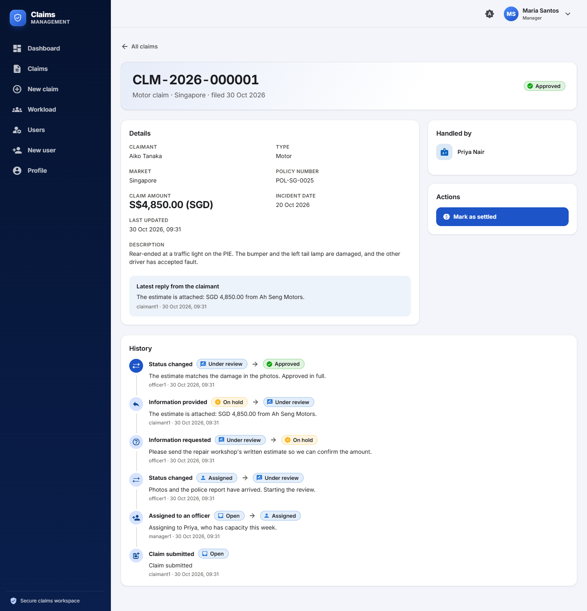
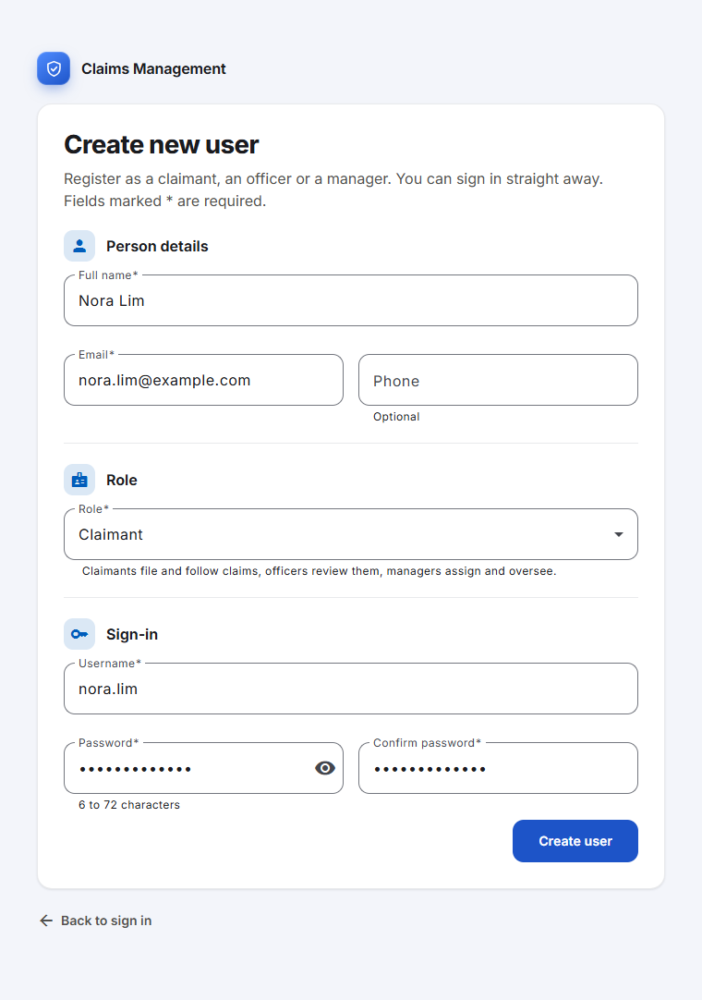
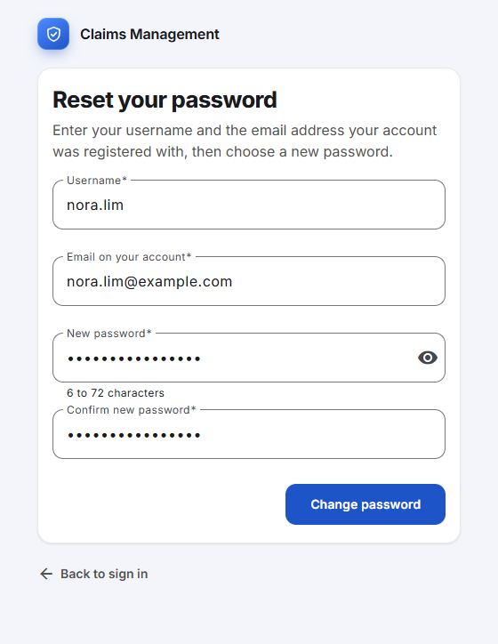
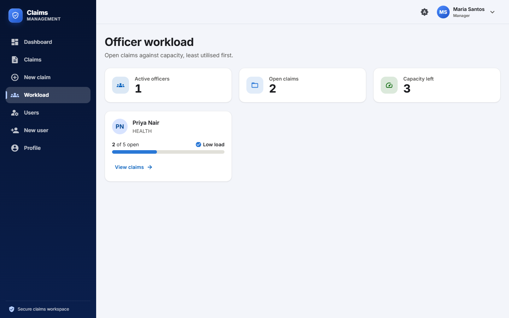

# Chubb APAC Claims Management

> One workspace for claimants, officers and managers to file, review and settle insurance claims across six APAC markets.


A claimant files a claim, a manager assigns it to an officer with spare capacity, and the officer works it through a status
workflow that keeps a full audit trail. People use an **Angular** web app; behind it a **Spring Boot** microservice backend
does the work. Everything goes through one gateway and is secured with JWT and three roles (`CLAIMANT`, `OFFICER`,
`MANAGER`).

This README covers setup and day-to-day use of both halves. How the system is built and why (service design, security model,
data, the claim workflow, the web app's structure, limitations) is in [architecture.md](architecture.md); the rules for
changing the code are in [CLAUDE.md](CLAUDE.md); how it was built with AI assistance is in [Ai_journal.md](Ai_journal.md).

**Contents:** [Highlights](#highlights) · [Screens](#screens) · [Quick start](#quick-start) · [Demo users](#demo-users) ·
[Roles at a glance](#roles-at-a-glance) · [Repository layout](#repository-layout) · [Backend](#backend) ·
[Web app](#web-app) · [Troubleshooting](#troubleshooting) · [Documentation](#documentation)

## Highlights

* **A complete claim lifecycle.** Open, assigned, under review, on hold while the claimant provides information, approved,
  rejected, settled, closed; every move is written to an append-only history with who, when and why.
* **Three roles, one workspace.** Claimants file and follow their own claims; officers work what is assigned to them (or pick
  up an open one); managers see everything, assign with live workload and a suggestion, or run a claim themselves with no
  officer at all.
* **Six APAC markets, each in its own currency.** Singapore, Hong Kong, Japan, Thailand, India and Indonesia. A claim is filed
  in the currency of its market (yen and rupiah take whole numbers); there is no conversion.
* **A policy number nobody types.** The server decides it when the claim is filed and the form previews it.
* **Workload that stays honest.** Capacity per officer, utilisation computed live, and the next assignee suggested.
* **Secure by construction.** Stateless JWT validated in every service, role checks on every call, and a web app whose own
  role checks only decide what to show.
* **Built to be checked.** Unit, slice and integration tests on the backend; unit and Playwright end-to-end tests on the web
  app; the rules the screen mirrors share their test examples with the server.

## Screens

| | |
|---|---|
|  |  |
| **Sign-in.** One screen on any window size, with **Forgot password?** and **Create new user** links; the demo-account buttons appear in development builds only. | **A claim.** Details, handler, next action and the full audit trail, including an information request and the claimant's reply. |
|  |  |
| **Create new user.** Open to anyone from the sign-in screen: person, role and sign-in, with the password asked for twice. Every role is on offer, by choice (see [Web app](#web-app)). | **Reset your password.** The username, the email the account was registered with and a new password. Nothing is mailed; see [Web app](#web-app) for what that means. |



**Workload.** Open claims against capacity for every officer, least utilised first.

## Quick start

You need JDK 21 for the backend and Node.js 22.22.3+, 24.15+ or 26+ for the web app. Two terminals, from the repository root:

```powershell
# 1. backend: builds the four services and starts them (H2, in memory)
cd backend-claim-management
.\scripts\start-all.ps1

# 2. web app: npm ci on the first run, then npm start
cd frontend
.\scripts\start-frontend.ps1
```

Open <http://localhost:4200> and sign in with a demo user below (the buttons on the login page fill them in). The backend
is on <http://localhost:8080>, with Swagger UI at <http://localhost:8080/swagger-ui.html>.

| What | Where |
|------|-------|
| Web app | http://localhost:4200 |
| API gateway (the only entry point) | http://localhost:8080 |
| user-service · claim-service · workload-service | 8081 · 8083 · 8084 (each answers `/actuator/health`) |

## Demo users

Created by `user-service` when its table is empty (`chubb.seed-demo-users`). The user id is what other services store (a
claim's `claimantId`, its `assignedOfficerId`). Data is in memory by default, so everything resets whenever the backend
restarts.

| Username    | Password      | Role       | Linked record                     |
|-------------|---------------|------------|-----------------------------------|
| `claimant1` | `claimant123` | CLAIMANT   | user id 1 (Aiko Tanaka, market JP) |
| `claimant2` | `claimant123` | CLAIMANT   | user id 2 (Wei Lim, market SG)    |
| `officer1`  | `officer123`  | OFFICER    | user id 3 (Priya Nair, cap. 5)    |
| `officer2`  | `officer123`  | OFFICER    | user id 4 (Daniel Chen, cap. 8)   |
| `manager1`  | `manager123`  | MANAGER    | user id 5 (Maria Santos)          |
| `claimant3` | `claimant123` | CLAIMANT   | user id 6 (Mei Chen, market HK)   |
| `claimant4` | `claimant123` | CLAIMANT   | user id 7 (Somchai Prasert, market TH) |
| `claimant5` | `claimant123` | CLAIMANT   | user id 8 (Arjun Mehta, market IN) |
| `claimant6` | `claimant123` | CLAIMANT   | user id 9 (Budi Santoso, market ID) |

**Demo claims.** `claim-service` also seeds 14 claims on first start (`chubb.seed-demo-claims`, set to `false` wherever the
demo users are off): a MOTOR and a PROPERTY claim in each of the six markets, plus a HEALTH claim (JP) and a TRAVEL claim
(SG), spread over every status from `OPEN` to `CLOSED` with their history. The seeded claimants have a market and a policy
number on their profile, so they file in that market only; users you create need neither.

## Roles at a glance

| | Claimant | Officer | Manager |
|---|----------|---------|---------|
| See claims | their own | all | all |
| File a claim | in their own name | in their own name | in their own name |
| Move a claim on | answer an information request | claims assigned to them, or pick up an unassigned open one | any claim, with or without an officer |
| Assign / reassign | – | – | yes, with live workload and a suggestion |
| Workload page | – | yes | yes |
| Users page and **New user** | – | any role | any role |

A manager runs the whole workflow on any claim, whoever it is assigned to: start the review (even on an open claim with no
officer), request information, approve, reject (a reason is required), settle and close, or hand it to an officer at any
point. These tables describe what the screen offers; the API table under [Backend](#backend) is what the server enforces.

## Repository layout

```
chubb/
├── README.md  CLAUDE.md  architecture.md  Ai_journal.md    the one set of documents for the whole application
├── docs/                    diagrams (SVG, each with a 2x PNG export) and the screenshots in docs/screens/
├── backend-claim-management/
│   ├── pom.xml              parent POM (Boot 3.3.5, Spring Cloud 2023.0.3, module list)
│   ├── common/              shared auto-configuration (JWT validation, exception handler, Feign, OpenAPI)
│   ├── api-gateway/         routes and aggregated Swagger UI (application.yml)
│   ├── user-service/        all users, login and token signing
│   ├── claim-service/       claims, assignment, status workflow, history
│   ├── workload-service/    stateless utilisation calculation
│   ├── scripts/start-all.ps1   Windows build-and-launch script
│   ├── test-payloads.json   sample request bodies, including negative cases
│   └── src/Main.java        IntelliJ template file; not part of any module
└── frontend/
    ├── src/app/             core, models, layout, features, shared, testing
    ├── e2e/                 Playwright specs
    ├── nginx/, Dockerfile   the production image
    ├── proxy.conf.json      the dev server's /api proxy to the gateway
    └── scripts/start-frontend.ps1   starts the dev server
```

The package structure inside each service, and the web app's folders, are described in [architecture.md](architecture.md).

## Backend

Java 21 and Spring Boot 3.3 microservices behind one gateway. Everything in this part runs from
`backend-claim-management/`.

### Services

| Module             | Port | Purpose                                                                |
|--------------------|------|------------------------------------------------------------------------|
| `api-gateway`      | 8080 | Single entry point: routing and an aggregated Swagger UI               |
| `user-service`     | 8081 | All users (claimants, officers, managers): profiles, roles, login and JWT issuing |
| `claim-service`    | 8083 | Claims, assignment, status workflow, history                           |
| `workload-service` | 8084 | Utilisation per officer, next-assignee suggestion                      |
| `common`           | –    | Shared library: security, exception handling, Feign auth, OpenAPI      |

### Prerequisites

* JDK 21 (`java -version`)
* Internet access on first build (Maven downloads dependencies). No local Maven needed – use `mvnw`.
* Optional: MySQL 8 for the `mysql` profile.

### Build & test

```powershell
.\mvnw.cmd clean install        # Windows   (./mvnw clean install on Linux/macOS)
```

Each service becomes a Spring Boot jar at `<module>/target/<module>-1.0.0.jar`. After editing `common`, run
`clean install`: the service jars are not repackaged when only a dependency changed.

JUnit 5 / Mockito tests run as part of the build (service logic, workflow rules, JPA repositories on H2,
controller security & validation via `@WebMvcTest`). The test inventory is in [architecture.md](architecture.md#10-backend-testing).

### Run

**One command (Windows):**

```powershell
.\scripts\start-all.ps1                 # H2 in-memory
.\scripts\start-all.ps1 -Profile mysql  # MySQL
```

**Manually** – start in this order, each in its own terminal, from `backend-claim-management/`:

```bash
./mvnw -q -DskipTests install
java -jar user-service/target/user-service-1.0.0.jar
java -jar claim-service/target/claim-service-1.0.0.jar
java -jar workload-service/target/workload-service-1.0.0.jar
java -jar api-gateway/target/api-gateway-1.0.0.jar
```

Or `./mvnw -pl <module> spring-boot:run`.

The start order is a convenience, not a requirement: a service boots even if the ones it calls are down, and calls to
them return 502 until they are up. Log in only after `user-service` is up.

Check http://localhost:8080/api/workload (log in as manager1) – a 200 means the gateway, workload, user and claim services are all reachable.
Every service also answers `/actuator/health` (8080, 8081, 8083, 8084).

#### Using MySQL instead of H2

H2 (in-memory, MySQL compatibility mode) is the default and needs no setup; the demo users are seeded
on start-up. To use MySQL run `user-service` and `claim-service` with `--spring.profiles.active=mysql`.
Databases `user_db` and `claim_db` are created automatically; set the connection per process (see `DB_URL`,
`DB_USERNAME` and `DB_PASSWORD` under [Configuration](#configuration)). Tables are generated from the JPA entities; demo
users and demo claims are only seeded into empty tables.
H2 consoles are available at `http://localhost:808{1,3}/h2-console` (JDBC URL `jdbc:h2:mem:<userdb|claimdb>`, user `sa`).

### Configuration

The defaults work for a local run. Override them with environment variables or `application.yml`.

| Setting | Env var | Default | Applies to |
|---------|---------|---------|------------|
| `server.port` | – | 8080 / 8081 / 8083 / 8084 | each service |
| `chubb.security.jwt.secret` | `CHUBB_SECURITY_JWT_SECRET` | built-in demo value, min. 32 characters | user, claim, workload (**must be identical**) |
| `chubb.security.jwt.issuer` | – | `chubb-claims-auth` | same three |
| `chubb.security.jwt.expiration-minutes` | – | 120 | user-service (signs) |
| `services.user.url` | `SERVICES_USER_URL` | `http://localhost:8081` | gateway, claim, workload |
| `services.claim.url` | `SERVICES_CLAIM_URL` | `http://localhost:8083` | gateway, workload |
| `services.workload.url` | `SERVICES_WORKLOAD_URL` | `http://localhost:8084` | gateway |
| `chubb.seed-demo-users` | – | `true` | user-service |
| `chubb.seed-demo-claims` | – | `true` | claim-service (uses the demo user ids, so keep it in step with `seed-demo-users`) |
| `spring.profiles.active` | – | none (H2) | user, claim: `mysql` |
| `DB_URL` / `DB_USERNAME` / `DB_PASSWORD` | same | per-service MySQL URL (`jdbc:mysql://localhost:3306/<db>`), `root` / `root` | user, claim, `mysql` profile only |

Set the JWT secret to the same value in every service and replace the built-in default outside local demos. Set both
`seed-demo-*` flags to `false` in production. Actuator exposes only `health` and `info`. The web app needs no settings of its
own in development: its `/api` proxy points at the gateway on 8080 (`frontend/proxy.conf.json`), and the production image takes
`API_UPSTREAM` (see [Web app](#web-app)).

### Using the API

#### Logging in

`POST /api/auth/login` (username + password, public) returns an `accessToken`, a signed JWT valid for 120 minutes by
default. Send it as `Authorization: Bearer <token>` on every other call through the gateway. How tokens are issued and
validated is described in [architecture.md](architecture.md#5-security).

Two more calls need no token, and are what the web app's **Create new user** and **Forgot password?** pages use:

```bash
# Sign up as any role (CLAIMANT, OFFICER or MANAGER); 201, and the account can log in at once
curl -s -X POST http://localhost:8080/api/auth/register -H "Content-Type: application/json" \
  -d '{"username":"nora","password":"secret123","role":"CLAIMANT","fullName":"Nora Lim","email":"nora@example.com"}'

# Set a new password from the username and the email the account was registered with; 204.
# An unknown user, an inactive account and a wrong email all answer 409 "Those details do not match an active account"
curl -s -X POST http://localhost:8080/api/auth/reset-password -H "Content-Type: application/json" \
  -d '{"username":"nora","email":"nora@example.com","newPassword":"another123"}'
```

Both are weak on purpose (anyone can sign up as a manager; a username and an email are enough to reset a password): see
[architecture.md](architecture.md#231-security).

#### Swagger UI

* **Aggregated, via the gateway:** http://localhost:8080/swagger-ui.html.
  1. Pick **user-service** in the top-right dropdown, run `POST /api/auth/login` with a demo user and copy the `accessToken`.
  2. Click **Authorize**, paste the token (no `Bearer ` prefix), click **Authorize** then **Close**.
  3. Switch to any other service in the dropdown and use **Try it out**; the token is remembered across reloads
     until it expires (then log in again).
* Per service: http://localhost:8081/swagger-ui.html (user), `:8083` (claim), `:8084` (workload).

#### Who can call what

| Endpoint                                   | CLAIMANT         | OFFICER                        | MANAGER |
|--------------------------------------------|------------------|--------------------------------|---------|
| `POST /api/claims`                         | own claim        | own claim, or for a claimant   | same as officer |
| `GET /api/claims`, `/{id}`, `/{id}/history`| own claims only  | all                            | all     |
| `PUT /api/claims/{id}/assignment`          | ✖                | ✖                              | ✔       |
| `PATCH /api/claims/{id}/status`            | own claim, only to answer an information request | only claims assigned to them | ✔ |
| `POST /api/auth/login`                     | ✔ (public)       | ✔ (public)                     | ✔ (public) |
| `POST /api/auth/register`                  | ✔ (public, any role) | ✔ (public, any role)       | ✔ (public, any role) |
| `POST /api/auth/reset-password`            | ✔ (public, username + email) | ✔ (public, username + email) | ✔ (public, username + email) |
| `GET /api/users/me`, `/api/users/{id}`     | own profile only | any user                       | any user |
| `GET /api/users?role=&active=`             | ✖                | ✔                              | ✔       |
| `POST /api/users`                          | ✖                | any role (including `MANAGER`) | any role |
| `PUT / DELETE /api/users/{id}`             | ✖                | ✖                              | ✔       |
| `GET /api/workload`, `/{officerId}`       | ✖                | ✔                              | ✔       |
| `GET /api/workload/suggestion`             | ✖                | ✖                              | ✔       |

The claim status workflow, markets, history and workload rules behind these endpoints are in
[architecture.md](architecture.md#7-claim-lifecycle-and-business-rules). Errors share one JSON shape (`timestamp`, `status`,
`error`, `message`, `path`, `details[]`); the status codes are listed there too.

#### Example walkthrough (through the gateway)

```bash
# 0. log in as each user (the response contains "accessToken"; here extracted with sed, or use jq -r .accessToken)
login() { curl -s -H "Content-Type: application/json" -X POST http://localhost:8080/api/auth/login \
  -d "{\"username\":\"$1\",\"password\":\"$2\"}" | sed -E 's/.*"accessToken":"([^"]+)".*/\1/'; }
CLAIMANT=$(login claimant1 claimant123); MANAGER=$(login manager1 manager123); OFFICER2=$(login officer2 officer123)

# 1. claimant files a claim (claimant id is taken from the logged-in user; the name must match their profile; the market is the one the claim is filed in, and must match the profile's only if it has one; the server adds the policy number)
curl -H "Authorization: Bearer $CLAIMANT" -H "Content-Type: application/json" -X POST http://localhost:8080/api/claims \
  -d '{"claimantName":"Aiko Tanaka","market":"JP","claimType":"MOTOR","description":"Rear-ended at lights","claimAmount":1500.00,"incidentDate":"2026-10-01"}'

# 2. manager asks which officer has capacity, then assigns the claim
curl -H "Authorization: Bearer $MANAGER" http://localhost:8080/api/workload/suggestion
curl -H "Authorization: Bearer $MANAGER" -H "Content-Type: application/json" -X PUT http://localhost:8080/api/claims/1/assignment \
  -d '{"officerId":4}'      # 4 = officer2 (Daniel Chen), a user id

# 3. the assigned officer works the claim
curl -H "Authorization: Bearer $OFFICER2" -H "Content-Type: application/json" -X PATCH http://localhost:8080/api/claims/1/status \
  -d '{"status":"UNDER_REVIEW","remarks":"Reviewing documents"}'
curl -H "Authorization: Bearer $OFFICER2" -H "Content-Type: application/json" -X PATCH http://localhost:8080/api/claims/1/status \
  -d '{"status":"APPROVED"}'

# 4. audit trail and workload
curl -H "Authorization: Bearer $CLAIMANT" http://localhost:8080/api/claims/1/history
curl -H "Authorization: Bearer $MANAGER" http://localhost:8080/api/workload
```

## Web app

An Angular 22 single-page app (Angular Material 3, standalone components, signals, zoneless) in `frontend/`. Everything in
this part runs from `frontend/`.

### Run it

You need the backend running first, then Node.js: the Angular CLI here requires **22.22.3+, 24.15+ or 26+** (developed on
26.3). Everything goes through the gateway on `:8080`.

```powershell
.\scripts\start-frontend.ps1   # npm ci (first time) + npm start
```

or by hand: `npm ci; npm start`, then open <http://localhost:4200>.

`npm start` proxies `/api` to `http://localhost:8080` (`proxy.conf.json`), so the browser only talks to its own origin and
**no CORS configuration is needed** (the gateway has none). The dev server's login page has one-click buttons for the demo
users; a production build does not contain them.

### What the screens do

* **Sign-in and session.** The token is kept in `sessionStorage` (it survives a refresh, not a closed tab). There is no
  refresh token: the app warns five minutes before the 120-minute expiry, signs the user out when it hits, and returns them
  to the page they were on after signing in again.
* **Claims.** The list shows every claim to staff (filters, and an **Assign** / **Reassign** button on each row for
  managers) and only their own to a claimant. A claim's page shows its details, who handles it, the actions available to
  the signed-in role, and the history timeline. The screen only offers moves the workflow allows
  (`features/claims/claim-workflow.ts` mirrors the backend's `ClaimStatus`); the server decides, and a 403 or 409 always wins.
* **New claim.** The same page for every role, and the same request: the claimant's name is the signed-in user's, and the form
  never sends a claimant id or a policy number. There is no edit or delete for a claim, because the API has none: a claim
  changes only through assignment and status moves, and "Close" is its end.
* **The market belongs to the claim, not to a person.** A claimant whose profile has a market sees it locked on the New claim
  page (the backend refuses any other); everyone else chooses it there. The New user form asks for no market.
* **The policy number is filled in, never typed.** The server decides it when the claim is filed: the claimant's own profile
  number if they have one (the seeded claimants do), otherwise a generated `POL-<market>-<user id>` such as `POL-SG-0012`,
  the same for the same person and market. It is a generated reference, not a lookup: the backend has no policy records. The
  New claim page previews it read-only (`shared/policy-number.ts` is the small copy of the server's rule) and the claim page
  shows what the server stored. Claims filed before this existed have none.
* **The currency follows the market.** The amount field shows the symbol and code and switches as the market is chosen; yen and
  rupiah take whole numbers. The amount reads the same in the list, the dashboard and the claim page.

  | Market    | Currency  | Decimals              |
  | --------- | --------- | --------------------- |
  | Singapore | SGD (S$)  | 2                     |
  | Hong Kong | HKD (HK$) | 2                     |
  | Japan     | JPY (¥)   | 0, whole numbers only |
  | Thailand  | THB (฿)   | 2                     |
  | India     | INR (₹)   | 2                     |
  | Indonesia | IDR (Rp)  | 0, whole numbers only |

  The table is `models/currency.ts`. There is **no conversion between currencies**: the backend stores the bare amount and has
  no currency field or exchange rates, so the market says which currency an amount is in. Amounts stored before this (the demo
  claims) are read as being in their market's currency.
* **Create new user and Forgot password, without signing in.** The sign-in screen links to both (**Forgot password?** under
  the password, **Create new user** under the button). **Create new user** (`/register`) is the staff New user form (person,
  role, sign-in) with every role on offer and the password asked for twice; it signs nobody in, it sends them back to the
  sign-in screen with a notice. **Forgot password?** (`/forgot-password`) asks for the username, the email the account was
  registered with and a new password (twice), and sets it. **Both are deliberately weak, by choice:** anyone can sign up as a
  manager, and anyone who knows a username and its email can reset that password, officers and managers included. Nothing is
  mailed (there is no mail server), and there is no rate limit or verification. See [CLAUDE.md](CLAUDE.md) and
  [architecture.md](architecture.md#231-security).
* **Users.** Staff can list users (**Users** in the side navigation) and register new ones (**New user**). The form is
  **Person details**, then a **Role** dropdown (Claimant, Officer or Manager), then the sign-in; no role adds a section of its
  own. An officer is registered with the server's default capacity of **5 open claims** and no specialization (the backend
  treats both as optional; only the API can change them afterwards). Officers and managers see the same form and may register
  any role: an officer can therefore create a manager account, which is deliberate (see [CLAUDE.md](CLAUDE.md)). Editing,
  deactivating and deleting users are not in the app (the API restricts those to managers).
* **Workload.** Officers' open claims against capacity, least utilised first (staff only).

### Scripts

| Command                           | What it does                                                    |
| --------------------------------- | --------------------------------------------------------------- |
| `npm start`                       | dev server on :4200 with the `/api` proxy                       |
| `npm run build`                   | production build into `dist/frontend-claims/browser`            |
| `npm test`                        | unit tests (Vitest); `npx ng test --no-watch` for a single run  |
| `npm run lint`                    | ESLint (angular-eslint, including template accessibility rules) |
| `npm run format` / `format:check` | Prettier                                                        |
| `npm run e2e`                     | Playwright against the real backend (see below)                 |

### Tests

* **Unit** (`*.spec.ts` beside the code, Vitest): API error parsing, auth and session timing, both interceptors, guards, the
  workflow rules, validators, currency and the policy-number rule, and the login, Create new user, Forgot password, status,
  New claim and New user screens.
* **End to end** (`e2e/`, Playwright): drive a real browser against the real stack, using the demo users. One spec walks a
  claim through the whole lifecycle across all three roles. Start the backend, then `npm run e2e`. It uses the Edge that
  ships with Windows (no browser download); set `E2E_BROWSER=chrome` for Chrome, or `E2E_BASE_URL` to test an
  already-running build. Tests file their own claims and register their own `e2e-` users (deleted again at the end), so they
  can be re-run without restarting the backend. Claims they leave behind are closed, so no officer is left at capacity; they
  stay in the list until `claim-service` restarts. The suite is written against the seeded demo users, so a database with
  different users fails any test that names a seeded one.

### Deploying

The `Dockerfile` builds the app and serves it with nginx (`nginx/`), which also proxies `/api/` to the gateway, so a deployed
browser still sees a single origin.

> The image has not been built or run yet: it was written on a machine without Docker. What _was_ checked is the production
> build behind the same Content-Security-Policy and `/api` proxying (no violations; the end-to-end suite passes). Expect to
> confirm the base image tags and the nginx config on the first real build.

```bash
docker build -t frontend-claims .
docker run -p 8080:8080 -e API_UPSTREAM=http://api-gateway:8080 frontend-claims
```

nginx sends a strict Content-Security-Policy (same-origin scripts, fonts and API), no-cache for `index.html`, long caching for
hashed assets, and refuses to cache `/api` responses. Terminate TLS in front of it: the token travels in a header and must
never cross plain HTTP. `/healthz` is the liveness probe. nginx resolves `API_UPSTREAM` at start-up, so the gateway's name must
resolve when the container starts (put both on one compose network).

## Troubleshooting

* **`JAVA_HOME` not defined / wrong Java** – Maven needs a JDK 21 (`$env:JAVA_HOME = "C:\Program Files\Java\jdk-21"`).
* **502 / connection refused from a service** – the downstream service is not started yet (or runs on another port). Service URLs default to `localhost:8081-8084`; override with `services.user.url`, `services.claim.url`, `services.workload.url`.
* **Port already in use** – change `server.port` in the service's `application.yml` (backend) or stop whatever holds 4200 (web app).
* **Build fails because a jar is locked, or two sets of services are running** – running jars lock their files and a double
  start leaves two sets of processes on the same ports. Stop **this project's** services before rebuilding or restarting, by
  their command line, which leaves IntelliJ and any other Java program alone:

  ```powershell
  Get-CimInstance Win32_Process |
    Where-Object { $_.Name -eq 'java.exe' -and $_.CommandLine -match '-1\.0\.0\.jar' } |
    ForEach-Object { Stop-Process -Id $_.ProcessId -Force }
  ```

  Where `java` on `PATH` is the Oracle launcher stub (`...\Common Files\Oracle\Java\javapath`), each service shows as two
  `java` processes (stub plus JVM), so expect 8 for 4 services.
* **Restarting `user-service` brings back the seeded users** and drops any you created (in-memory data). Restart
  `claim-service` to clear its claims. Keep `chubb.seed-demo-claims` in step with `chubb.seed-demo-users`: the demo claims
  refer to the demo user ids.
* **`node` or `npm` not found** – install a supported Node (see the web app's Run it); `scripts\start-frontend.ps1` falls back
  to `C:\Program Files\nodejs` when it is installed but not on `PATH`.
* **The dev server shows odd errors after several files were edited at once** – a rebuild can fail halfway and leave it
  serving an old bundle. Check its log for "Application bundle generation complete", then stop `ng serve` and start it again.
* **End-to-end tests time out** – they are slow on a busy machine (a 60-second limit per test, one worker). Close other heavy
  programs, and run them with the backend freshly started.
* **Where are the logs?** – On the console. When the services are started hidden with redirected output, look in
  `%TEMP%\cms-logs\<service>.out.log` and `.err.log`.

## Documentation

| Document | What it is for |
|----------|----------------|
| [README.md](README.md) | This file: what the project is, how to run it, how to use it |
| [architecture.md](architecture.md) | How the whole system is built and why: services, security, data, the claim lifecycle, the web app, the contracts between them, trade-offs, limitations |
| [CLAUDE.md](CLAUDE.md) | Rules for changing the code, for contributors and for Claude Code, backend and web app |
| [Ai_journal.md](Ai_journal.md) | An honest account of how AI was used to build the system, and what it taught |
| [backend-claim-management/test-payloads.json](backend-claim-management/test-payloads.json) | Sample request bodies, including negative cases |
