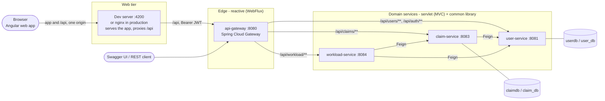
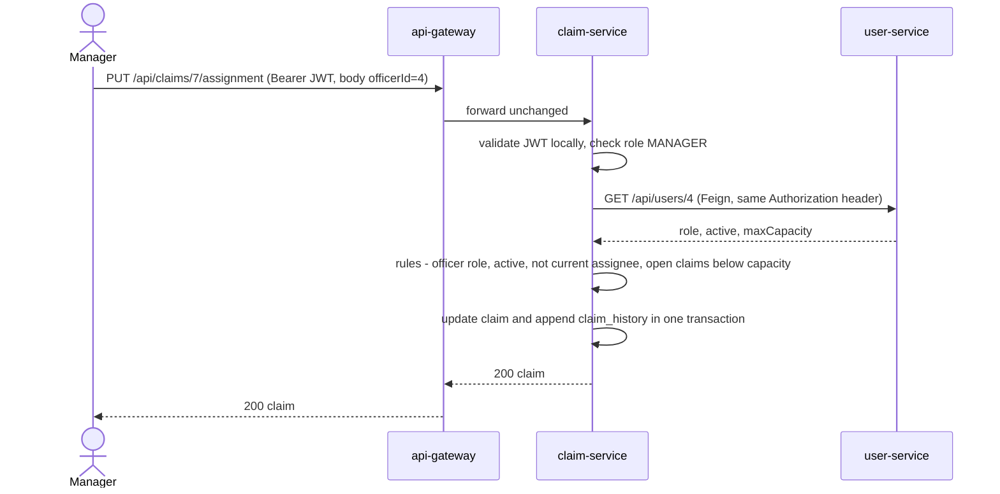
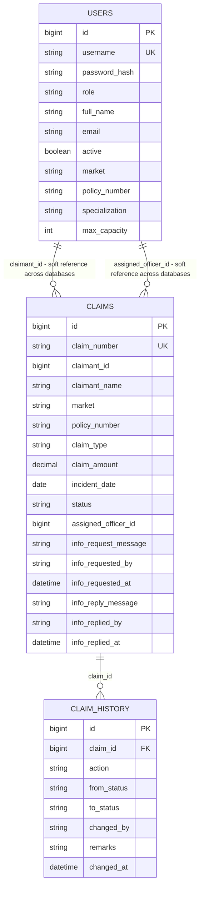
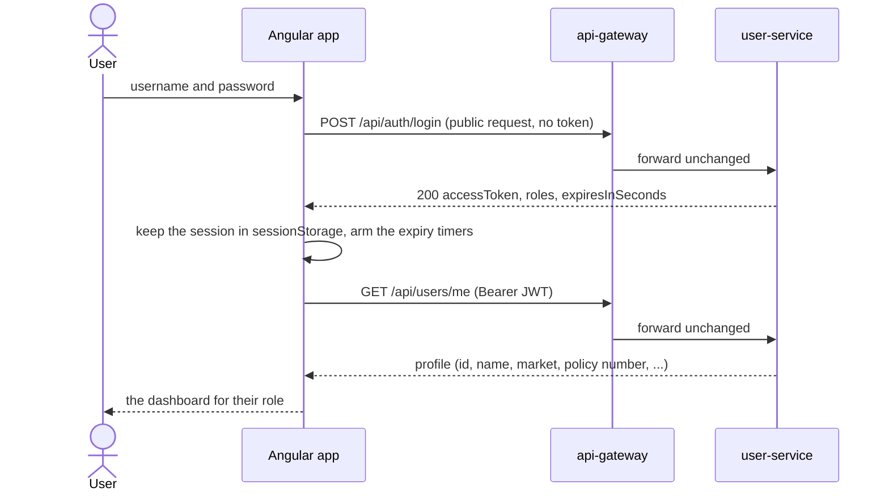
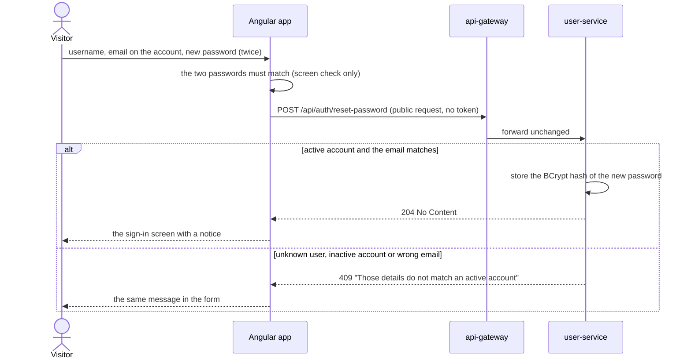

# Architecture – Chubb APAC Claims Management

How the whole application is put together and why: the Angular web app, the Spring Boot microservices behind it, and the
contracts between the two. For setup, configuration, demo users and an API walkthrough see [README.md](README.md); for the
rules to follow when changing code see [CLAUDE.md](CLAUDE.md); for how the system was built with AI assistance, and what
that taught, see [Ai_journal.md](Ai_journal.md).

The pictures are in `docs/` (SVG, each with a 2x PNG export; the technology-stack banner and the screenshots are in the
README). The remaining diagrams use [Mermaid](https://mermaid.js.org/), which GitHub renders inline.

**Contents**

| Part | Sections |
|------|----------|
| The whole system | [1 Overview](#1-overview) · [2 System context](#2-system-context) · [20 End-to-end flows](#20-end-to-end-flows) · [21 Frontend and backend contracts](#21-frontend-and-backend-contracts) · [22 Design decisions and trade-offs](#22-design-decisions-and-trade-offs) · [23 Known limitations](#23-known-limitations) |
| Backend (Spring Boot) | [3 Modules](#3-modules) · [4 Request flow](#4-request-flow) · [5 Security](#5-security) · [6 Data](#6-data) · [7 Claim lifecycle and business rules](#7-claim-lifecycle-and-business-rules) · [8 Workload calculation](#8-workload-calculation) · [9 Cross-cutting concerns](#9-cross-cutting-concerns-common) · [10 Backend testing](#10-backend-testing) |
| Web app (Angular) | [11 Overview and structure](#11-frontend-overview-and-structure) · [12 Routing and guards](#12-frontend-routing-guards-and-role-aware-ui) · [13 Sign-in and session](#13-frontend-sign-in-and-session) · [14 HTTP layer and errors](#14-frontend-http-layer-and-errors) · [15 Data, state and forms](#15-frontend-data-loading-state-and-forms) · [16 Rules the screen mirrors](#16-frontend-rules-the-screen-mirrors) · [17 Design system](#17-frontend-design-system-responsive-layout-and-accessibility) · [18 Testing](#18-frontend-testing) · [19 Delivery](#19-frontend-delivery) |

## 1. Overview

A claims platform for filing, assigning and tracking insurance claims across six APAC markets. A claimant files a claim, a
manager assigns it to an officer with spare capacity, and the officer works it through a status workflow that keeps a full
audit trail. It is two deployable halves in one repository:

* **Web app** (`frontend/`): an Angular 22 single-page app (Angular Material 3, standalone components, signals, zoneless
  change detection). It talks to the backend only through the gateway, with a relative `/api` base, so the browser sees one
  origin and no CORS is configured anywhere.
* **Backend** (`backend-claim-management/`): four deployable Spring Boot applications (gateway, user, claim, workload) that
  share one Maven build and one library. Java 21, Spring Boot 3.3.5, Spring Cloud 2023.0.3 (Gateway, OpenFeign), Spring
  Security (JWT resource server), Spring Data JPA, springdoc-openapi 2.6.0.

What holds across both halves:

* **The server is the authority.** The web app mirrors a few rules (the claim workflow, the currency of a market, a policy
  number preview) only to decide what to offer; the services enforce every rule, and a 403 or 409 always wins (section 21).
* **Synchronous REST only.** No message broker, no service registry, no shared database.
* **Stateless services.** Identity travels in a signed JWT; nothing is kept in an HTTP session. The browser keeps the token in
  `sessionStorage` for the life of a tab (section 13).
* Data is in-memory H2 by default (resets on restart) and can be switched to MySQL per service.

## 2. System context


The picture is `docs/system-architecture.svg` (2x export: `docs/system-architecture.png`). The same system as a Mermaid diagram:



Clients only ever talk to the gateway. The browser loads the app and calls `/api` on a single origin: in development the
Angular dev server proxies `/api` to the gateway (`proxy.conf.json`), in production nginx does (section 19). Service-to-service
calls go directly between services (not back through the gateway) using OpenFeign at fixed URLs.

## 3. Modules

| Module | Port | Stack | Owns | Responsibility |
|--------|------|-------|------|----------------|
| `api-gateway` | 8080 | WebFlux, Spring Cloud Gateway, springdoc webflux-ui | – | Single entry point: path routing, aggregated Swagger UI, redirects of common wrong URLs to `/swagger-ui.html`. No security, no business logic. Does **not** depend on `common`. |
| `user-service` | 8081 | MVC, JPA, `common` | `users` table | Every person in the system (claimants, officers, managers): profile, role, officer capacity, active flag. Login and JWT signing. Seeds demo users. |
| `claim-service` | 8083 | MVC, JPA, `common` | `claims`, `claim_history` | Claim submission, assignment, status workflow, audit history, per-officer open-claim counts. Seeds demo claims. |
| `workload-service` | 8084 | MVC, `common` | nothing (stateless) | Utilisation per officer and next-assignee suggestion, computed live from the two services above. |
| `common` | – | plain jar | – | Shared auto-configuration: JWT validation and method security, global exception handler, Feign auth forwarding, OpenAPI bearer scheme. |
| `frontend` (not a Maven module) | 4200 in development; 8080 inside its Docker image | Angular 22, Material 3, TypeScript | nothing (a stateless client; the session lives in the browser's `sessionStorage`) | The web UI for all three roles. Calls only `/api` through the gateway. Described in sections 11 to 19. |

Dependencies between services, as call direction:

```
workload-service ──► claim-service ──► user-service
        └──────────────────────────────────▲
```

There are no cycles, so `user-service` can run on its own; `claim-service` needs `user-service`; `workload-service`
needs both. Feign clients call lazily at fixed URLs, so a service still boots when its dependencies are down; calls to
them fail with 502 until they are up.

### Package structure

Every backend service uses package-by-layer: `controller → service → repository → entity`, with `dto` records for request
and response bodies. Controllers never touch repositories. The directory tree is in the README.

* `user-service`: the layers above plus `config`.
* `claim-service`: the layers plus `client` (Feign), `model` (enums, state machine) and `security` (`Caller`).
* `workload-service`: `client` (Feign) and `model` (`OfficerWorkload`).
* `api-gateway`: the routes are in `application.yml`.
* `common`: shared auto-configuration only (section 9).
* `frontend`: package-by-feature rather than by layer; see section 11.

## 4. Request flow

### 4.1 Routing

The gateway matches on path prefix and forwards the request unchanged, including the `Authorization` header:

| Path | Target |
|------|--------|
| `/api/users/**`, `/api/auth/**` | user-service |
| `/api/claims/**` | claim-service |
| `/api/workload/**` | workload-service |
| `/docs/<service>/v3/api-docs` | that service's `/v3/api-docs` (prefix stripped, `Host` header preserved so the OpenAPI "server" URL shows the gateway) |

Downstream base URLs come from the `services.{user,claim,workload}.url` settings (defaults and environment variables are
under Configuration in the README). The Feign clients in `claim-service` and `workload-service` read the same
`services.*.url` properties.

### 4.2 Example: a manager assigns a claim



### 4.3 Inside one service

```
HTTP ─► JWT filter ─► controller ─► service ─► repository ─► database
          │             @PreAuthorize   business rules,        Spring Data JPA
          │             @Valid          ownership checks,
          │                             @Transactional, Feign
          └─ any exception ─► GlobalExceptionHandler ─► ApiError JSON
```

## 5. Security

### 5.1 Authentication

1. `POST /api/auth/login` goes to `user-service`. It is one of three public API endpoints; the other two, sign-up and
   password reset, are described after this list.
2. `AuthService` looks the user up, requires `active`, and checks the password against its BCrypt hash. Unknown user,
   wrong password and disabled account all return the same 401 message so usernames cannot be probed.
3. `TokenService` signs an **HS256** JWT: `iss = chubb-claims-auth`, `sub = username`, `roles = [<ROLE>]`, `iat`,
   `exp` (default 120 minutes).
4. The client sends `Authorization: Bearer <token>` on every later call.

**Sign-up and password reset need no token** (added 2026-10-30, linked from the sign-in screen). Both are in `AuthService` and
both are deliberately weak, by the user's choice (sections 22 and 23.1):

* `POST /api/auth/register` creates an active account of **any role the visitor picks, `MANAGER` included**. It takes the
  staff form's person, role and sign-in fields and nothing more (no `active`, `market`, policy number, specialization or
  capacity), then calls `UserService.create`, so the duplicate-username 409 and the officer's default capacity are the same
  as for a user a manager creates.
* `POST /api/auth/reset-password` sets a new password for whoever names an **active** account and the **email registered
  with it** (compared ignoring case and surrounding spaces). Nothing is mailed: there is no mail server. An unknown user, an
  inactive account and a wrong email all give the same 409 message, like the login's one 401 message, so the response says
  which part was wrong to nobody. Tokens already issued stay valid (there is no revocation).

Every servlet service validates the token **locally** with the shared secret (`chubb.security.jwt.secret`, env
`CHUBB_SECURITY_JWT_SECRET`): signature, issuer and expiry. There is no call back to `user-service` per request. Roles
in the `roles` claim become `ROLE_<name>` authorities.

### 5.2 Authorization – two layers

| Layer | Where | Examples |
|-------|-------|----------|
| Role gate | `@PreAuthorize` on controller methods (`@EnableMethodSecurity` in `common`) | assignment is `MANAGER` only; status update is `CLAIMANT`/`OFFICER`/`MANAGER` (the service narrows the claimant, see below); workload is `OFFICER`/`MANAGER` |
| Ownership and state | service layer | a claimant sees only their own claims; officers can only update claims assigned to them (or pick up an unassigned `OPEN` one), while managers can update any claim, including reviewing an `OPEN` one with no officer; through the status endpoint a claimant can only answer an information request on their own claim (`UNDER_REVIEW`, 403 for any other status); claimants can read only their own profile; **officers can create a user of any role, `MANAGER` included** (so an officer can create an account more privileged than their own; only update and delete of users are manager-only), a deliberate product choice, not an oversight; **and anyone can sign up for any role without signing in** (section 5.1), also a deliberate choice |

The full endpoint-by-role table is in the README.

### 5.3 Identity propagation

* The gateway forwards the `Authorization` header untouched. It does not authenticate anything: an unauthenticated
  request is rejected by the **downstream** service, not at the edge.
* `FeignConfig` (in `common`) copies the incoming `Authorization` header onto every outgoing Feign call, so a
  downstream service enforces the **original caller's** role. There is no service-to-service credential.
* The token carries the **username, not the user id**. When `claim-service` needs the caller's id (for a claimant's own
  claims, or an officer's capacity) it calls `GET /api/users/by-username/{username}`. Claimants may read their own
  profile, so this works with the claimant's own token.

### 5.4 Public paths (every service)

`/api/auth/login`, `/api/auth/register`, `/api/auth/reset-password`, `/swagger-ui*`, `/v3/api-docs/**`,
`/actuator/health/**`, `/actuator/info`, `/h2-console/**`, plus `OPTIONS`. (Only `user-service` has the three `/api/auth/`
handlers; the list lives once, in `common`'s `SecurityConfig`.) CSRF is disabled (stateless bearer tokens, no cookies) and sessions are never created.

### 5.5 What the browser adds

* **No CORS.** The gateway has no CORS configuration on purpose. The web app calls a relative `/api` on its own origin and a
  proxy (the dev server, or nginx) forwards it, so the browser never makes a cross-origin call.
* **Token handling.** The app keeps the JWT in `sessionStorage` and sends it only on calls to its own `/api` (sections 13 and
  14). A script on the page could read it; the Content-Security-Policy sent by nginx (section 19) is the mitigation.
* **The UI's role checks are not security.** Guards and the `HasRole` directive only hide what the server would refuse
  (section 12); every endpoint above is protected by the services themselves.

## 6. Data

### 6.1 Ownership

Each service owns its own database; nobody queries another service's tables. Cross-service references are **plain
columns**, not foreign keys or joins.



`USERS` lives in user-service's database; `CLAIMS` and `CLAIM_HISTORY` in claim-service's. Only the last relationship
is a real foreign key.

* **One `users` table for all roles.** The role decides which profile columns apply: claimants use `market` and
  `policy_number`, both optional; officers use `specialization` (optional, display only) and `max_capacity` (optional on
  the API, but never empty: when omitted, create and update store the default of 5, because assignment and workload read
  a missing capacity as 0 and the officer would be "full" for good). No profile field is mandatory for any role.
* **Markets and claimant names.** `Market` (`SG`, `HK`, `JP`, `TH`, `IN`, `ID`) is an enum in `common`, stored by name.
  `POST /api/claims` requires `claimantName` and `market` in the body: the market is chosen when the claim is filed, not
  taken from the user. `ClaimService.create` compares the name with the claimant's `UserSummary`, already fetched through
  Feign (`fullName` ignoring case and spaces), and answers 409 on a mismatch. A claimant whose profile has a market (the
  demo claimants) can only file in it (409 otherwise); a claimant without one files in the market sent. The claim then stores
  the profile's name and the requested market (`claimant_name`, `market`) as snapshots taken at filing time. These columns
  are nullable in the database (`ddl-auto=update` cannot add `NOT NULL` to a table that already has rows) and non-null is
  enforced in code. `GET /api/claims` filters by `market` and `claimType`.
* **Policy number.** Every new claim is stored with a `policy_number` that the **server** decides when it is filed and the client can
  neither send nor change (`ClaimService.policyNumberFor`): the claimant's own profile policy number when they have one (the seeded
  claimants do), otherwise a generated `POL-<market>-<user id>` such as `POL-SG-0012`, stable for a person and market. It is a
  reference, not a lookup: there are no policy records. The column is nullable (claims filed earlier have none) and is shown on
  `GET /api/claims/{id}`, in the list and in the status-update response. The frontend previews the same rule
  (`shared/policy-number.ts`); the two share one table of examples in their tests, so change them together.
* **Claim numbers** have the form `CLM-<year>-<id padded to 6>` (for example `CLM-2026-000042`). The row is first saved
  with a temporary number, then renamed once the generated id exists, in the same transaction.
* **`claim_history` is append-only.** Its columns are `updatable = false`. One row is written for every creation,
  assignment, reassignment, status change, information request and reply, recording who (`changed_by` = username), when, and from → to. The history
  endpoint also returns each entry's `claimId`, `claimantName` and `market`, read from the entry's claim, which the
  history query loads with an entity graph (the `claim` association is lazy and there is no open session at
  serialisation time).

### 6.2 Persistence setup

| | Default | `--spring.profiles.active=mysql` |
|---|---------|----------------------------------|
| Database | in-memory H2 in MySQL mode: `jdbc:h2:mem:userdb`, `jdbc:h2:mem:claimdb` | `user_db`, `claim_db` on `localhost:3306`, created on demand |
| Schema | `spring.jpa.hibernate.ddl-auto=update`, generated from the entities | same |
| Seed data | `DemoDataSeeder` in user-service when the users table is empty (`chubb.seed-demo-users`); `DemoClaimSeeder` in claim-service when the claims table is empty (`chubb.seed-demo-claims`) | same |

Entities stay portable between H2-in-MySQL-mode and MySQL: no vendor-specific types or queries. `workload-service` has
no database at all. Connection overrides and the H2 console are covered in the README (Run and Configuration).

## 7. Claim lifecycle and business rules

The only legal moves are defined once, in `ClaimStatus.canTransitionTo`.


The picture (`docs/claim-status-flow.svg`, with a 2x export in `docs/claim-status-flow.png`) shows who makes each move.

Rules enforced in `ClaimService`:

* **Submit.** A claimant files for themselves (id taken from their token). So does an officer or manager who gives no
  `claimantId`: the claim is then in **their own name** (`claimantId` is their user id). An officer or manager who does give a
  `claimantId` files on that person's behalf, and it must belong to a `CLAIMANT`. New claims start `OPEN`. `claimantName` and
  `market` are required in the body and `claimantName` must match the profile of whoever the claim is for (section 6.1); a
  mismatch is 409. A staff-owned claim has two consequences nobody has addressed: staff can still approve or settle a claim they
  filed themselves (no segregation of duties), and if it goes `ON_HOLD` only a claimant can reply, so staff can only close it.
* **Assign / reassign** (manager only). Allowed while the claim is `OPEN`, `ASSIGNED`, `UNDER_REVIEW` or `ON_HOLD`. The target must
  be an **active `OFFICER`** user, not already the assignee, with `open claims < maxCapacity`. Status moves `OPEN →
  ASSIGNED`; reassigning keeps the current status.
* **Status change** (officer or manager). `ASSIGNED` cannot be set through the status endpoint, only by assignment. Officers
  may update a claim assigned to them, or pick up an unassigned `OPEN` claim (self-assigns, capacity-checked, writes an
  `ASSIGNED` history row first). A claim assigned to a different officer returns 403 "Claim is not assigned to
  you". Managers may update any claim. A manager may also move an `OPEN` claim straight to `UNDER_REVIEW` with no officer (the blue arrow in the picture): the claim stays unassigned and counts towards nobody's workload, the history records the manager, and from there the manager can request information, approve, reject, settle and close it, or assign an officer at any point (a first assignment that keeps the status). An officer cannot act on such a claim: it is not `OPEN` and has no officer, so they get the same 403 "Claim is not assigned to you". `REJECTED` and `ON_HOLD` require `remarks`.
* **Request more information** (officer on their own claim, or manager). Moving a claim from `UNDER_REVIEW` to
  `ON_HOLD` through the status endpoint stores the remarks as the request (`info_request_message`, `info_requested_by`,
  `info_requested_at`) and writes an `INFO_REQUESTED` history row. The claim JSON shows it as `infoRequest` (`message`, `requestedBy`, `requestedAt`) while it is open, so the claimant sees
  what to provide.
* **Provide information** (the owning claimant only, through the same `PATCH /api/claims/{id}/status`: status
  `UNDER_REVIEW`, the reply as `remarks`). `ClaimService.updateStatus` sends a claimant to its own branch before any officer
  logic, so there is no pick-up or capacity check. Checks in order: claim exists (404), it is their own claim (403), the
  target is `UNDER_REVIEW` (403 for any other status), the claim is `ON_HOLD` (409 otherwise), remarks are not blank
  (409; at most 500 characters). It then stores the reply (`info_reply_message`, `info_replied_by`, `info_replied_at`, shown
  as `lastReply` with `message`, `repliedBy`, `repliedAt`), writes an
  `INFO_PROVIDED` history row and moves the claim back to `UNDER_REVIEW` in the same transaction, so no staff step is needed
  to resume review.
* **On hold while information is required.** A claim in `ON_HOLD` does not move until the claimant answers. In the
  staff path of `ClaimService.updateStatus`, any target other than `CLOSED` is refused with 409 "Claim is on hold", checked
  before the transition and remarks rules, so an officer or manager cannot resume, approve, reject or settle it. `ClaimStatus`
  still lists `ON_HOLD` to `UNDER_REVIEW` as a legal move, because the claimant's reply uses it; who may make the
  move is the service rule above. Staff can still close the claim (a claimant who never replies) and a manager can reassign it.
* **Illegal moves** return 409 listing the allowed next statuses.
* **List and filter.** `GET /api/claims` returns every claim to officers and managers and only their own to a claimant.
  The filters `market`, `claimType`, `status`, `claimantId` and `assignedOfficerId` are all optional and combinable; an
  unknown market or type returns 400. Every claim shows `claimantName`, `market` and `claimantId`.
* **Status update response.** `PATCH /api/claims/{id}/status` returns the updated claim with all its usual fields, plus
  `previousStatus` (the status before the request) and the `remarks`, `changedBy` and `changedAt` of the change. When an
  officer's update also picks up an `OPEN` claim, `previousStatus` is `OPEN` and the history lists the `ASSIGNED` step too.

"In progress" (`ClaimStatus.IN_PROGRESS` = `ASSIGNED` + `UNDER_REVIEW` + `ON_HOLD`) is the single definition of "open"
used for both the capacity check and the workload numbers: an officer still owns a claim that has asked the claimant for more information.

## 8. Workload calculation

`workload-service` holds no data. For each request it makes two calls:

1. `user-service` `GET /api/users?role=OFFICER&active=true` – who is eligible and each person's `maxCapacity`.
2. `claim-service` `GET /api/claims/stats/open-by-officer` – map of officer id → in-progress claim count.

Per officer: `utilization % = open / maxCapacity × 100` (one decimal, half-up; 100 if `maxCapacity ≤ 0`) and
`available = max(0, maxCapacity − open)`.

| Level | Utilisation |
|-------|-------------|
| `LOW` | below 50 % |
| `MODERATE` | 50 % to below 80 % |
| `HIGH` | 80 % to below 100 % |
| `FULL` | 100 % or more |

The list is sorted least utilised first (ties by id). The suggestion is the first entry with spare capacity; if there
is none the call returns 409.

## 9. Cross-cutting concerns (`common`)

`common` is a plain jar. `META-INF/spring/org.springframework.boot.autoconfigure.AutoConfiguration.imports` registers
`CommonAutoConfiguration`, which imports four configurations, so any servlet service gets them just by depending on
the jar:

| Config | Provides |
|--------|----------|
| `SecurityConfig` | Stateless filter chain, JWT decoder (HS256 + issuer check), role-claim → authority mapping, JSON 401 entry point, `@EnableMethodSecurity` |
| `GlobalExceptionHandler` | The only place exceptions become HTTP responses (`ApiError`) |
| `FeignConfig` | `Authorization` header forwarding; downstream 404 → `ResourceNotFoundException` |
| `OpenApiConfig` | OpenAPI title plus a bearer-JWT scheme so Swagger's **Authorize** works |

The gateway is reactive and cannot use the servlet-based `SecurityConfig`, which is why it does not depend on `common`.

### Error model

One JSON shape everywhere: `timestamp`, `status`, `error`, `message`, `path`, `details[]`.

| Cause | Status |
|-------|--------|
| Bean validation failure (field errors in `details`), malformed JSON, bad parameter type | 400 |
| Bad login | 401 |
| `AccessDeniedException` (role or ownership) | 403 |
| `ResourceNotFoundException`, unknown route | 404 |
| Wrong HTTP method / media type | 405 / 415 |
| `BusinessRuleException` (illegal transition, capacity, not an officer), unique-constraint violation | 409 |
| Downstream 4xx (other than 404) is relayed; downstream 5xx or connection failure | 4xx as-is / 502 |
| Anything else | 500 (details logged, not returned) |

The 401 for a **missing or expired token** is written by the security filter before MVC is reached, so it has a slimmer
body: `status`, `error`, `message` only, with a hint to log in again.

## 10. Backend testing

JUnit 5, Mockito and AssertJ; run with the build. The web app's tests are in section 18.

| Module | Tests |
|--------|-------|
| `claim-service` | `ClaimStatusTest` (state machine), `ClaimServiceTest` (rules, Mockito), `ClaimRepositoryTest` (JPA on H2), `ClaimControllerTest` (`@WebMvcTest`: who may call what, validation, response shape), `StatusUpdateResponseTest` (the status response repeats every claim field), `DemoClaimSeederTest` (demo data respects the workflow and officer capacity) |
| `user-service` | `UserServiceTest`, `AuthServiceTest`, `UserRepositoryTest`, `UserControllerTest` (controller security and validation), `AuthFlowIntegrationTest` (real login, real token, real filter chain) |
| `workload-service` | `WorkloadServiceTest` |
| `common`, `api-gateway` | none |

`workload-service` has no controller-level tests.

## 11. Frontend: overview and structure

The web app is an Angular single-page application in `frontend/`.

| | |
|---|---|
| Framework | Angular 22: standalone components, signals, zoneless change detection, the `@if` / `@for` / `@let` control flow, `input()` / `output()` |
| UI | Angular Material 3 and the CDK, plus a design system of CSS variables in `src/styles.scss` (section 17) |
| Language and data | TypeScript 6 in strict mode; RxJS 7 for HTTP and form streams |
| Tests | Vitest for unit tests, Playwright for end-to-end tests against the real stack (section 18) |
| Quality | ESLint with angular-eslint (including the template accessibility rules) and Prettier |
| Runtime | Node.js 22.22.3+, 24.15+ or 26+ for the CLI; `ng serve` in development, nginx in production (section 19) |

```
frontend/src/app
├─ core/       singletons: auth (session, guards), http (interceptors, error parsing), config, notifications, theme
├─ models/     TypeScript shapes of the backend's DTOs and enums, and the currency table
├─ layout/     the shell: toolbar and side navigation
├─ features/   auth (sign-in, create new user, reset password), dashboard, claims, workload, profile, errors, users (each lazy-loaded)
├─ shared/     brand mark, auth frame, avatar, status chip, workload meter, state message, confirm dialog, pipes,
│              validators, role directive, dates, money, policy number, load-state
└─ testing/    test helpers (a fake JWT)
```

| Feature | What it holds |
|---------|---------------|
| `auth` | The login page: a split screen that fits one window, with demo-account buttons in development builds only |
| `dashboard` | A summary per role: a claimant's own claims; staff see every claim, what needs an officer, and capacity |
| `claims` | The claims list (filters, assign button on each row for managers), the claim page (details, history timeline, actions), the new-claim form, and the status and assign dialogs; `claim-workflow.ts` holds the move rules the screen mirrors |
| `workload` | Officers' open claims against capacity, least utilised first (staff only) |
| `users` | The users list and the New user form (staff only), and `UserDirectory`, a staff-only cache that turns user ids into names |
| `profile`, `errors` | The signed-in user's profile; the "no access" and "not found" pages |

A feature talks to the backend only through its own API service (`claims-api`, `users-api`, `workload-api`) or `AuthService`;
components never use `HttpClient` directly.

## 12. Frontend: routing, guards and role-aware UI

Every page is loaded lazily. Routes and who may reach them:

| Route | Who | Guards |
|-------|-----|--------|
| `/login` | anyone not signed in | `guestGuard` sends a signed-in user to the dashboard |
| `/register`, `/forgot-password` | anyone not signed in | `guestGuard`; linked from the sign-in screen ("Create new user", "Forgot password?"); top-level routes outside the shell, drawn by `AuthFrame` |
| everything below, inside the shell | signed-in users | `authGuard`: loads the profile after a refresh; if it cannot, the session is dropped and the user goes to `/login` with the page they wanted |
| `/dashboard`, `/profile` | all roles | none beyond sign-in |
| `/claims`, `/claims/:id` | all roles | the server decides what each role sees |
| `/claims/new` | all roles | `unsavedChangesGuard` asks before a half-filled form is thrown away |
| `/workload` | officer, manager | `roleGuard` (`data.roles`), otherwise `/forbidden` |
| `/users`, `/users/new` | officer, manager | `roleGuard`; `/users/new` also has the unsaved-changes guard |
| `/forbidden`, any other path | signed-in users | the "no access" and "not found" pages |

The `HasRole` directive hides controls (side navigation entries, the Assign button) from roles the server would refuse
anyway. **Guards and `HasRole` decide only what is offered**: the services enforce the same rules on every call, and a 403
is shown, not hidden. Route parameters arrive through component input binding (`withComponentInputBinding`), and every route
has a page title.

## 13. Frontend: sign-in and session

1. The login page posts to `POST /api/auth/login`, marked as a **public request**: no token is attached and a 401 is left to
   the page (a wrong password is not an expired session).
2. The response holds the JWT, the roles and the lifetime. `AuthService` decodes the token only to learn when it expires,
   and keeps `{ token, username, roles, expiresAt }` in `sessionStorage` (`TokenStorage`): it survives a refresh and dies with
   the tab. Where storage is blocked the session lives in memory and a refresh signs the user out.
3. The token carries the username, not the user id, so every session next reads `GET /api/users/me` into the profile signal.
   After a refresh `authGuard` reloads it.
4. **Timers.** Five minutes before the 120-minute expiry the app warns the user; at expiry it signs them out and goes to
   `/login?reason=expired&returnUrl=<where they were>`. A 401 from any protected call does the same. There is no refresh token.
5. After signing in the user returns to that page. Only same-app paths are followed (`safeReturnUrl` drops absolute and
   protocol-relative URLs).
6. The roles kept in the session choose what the UI shows. They are never the access check.
7. **Before signing in.** The sign-in screen links to `/register` and `/forgot-password`. Both pages are public requests like
   the login (no token, the form shows the failure) and **neither starts a session**: on success they go back to
   `/login?reason=registered` or `/login?reason=password-reset`, which shows a notice, and the person signs in with the new
   credentials. `/register` has the staff New user page's three sections (person, role, sign-in) and every role, without the
   Active switch; a taken username lands on its field. `/forgot-password` asks for the username, the email on the account and a
   new password. Both ask for the password twice, a check on the screen only (`sameAs`). The sign-in screen stays exactly one
   screen with the two links added; these two pages are taller and may scroll.

## 14. Frontend: HTTP layer and errors

The base URL is a relative `/api` (`API_BASE_URL`). Two functional interceptors run on every request, in this order:

| Interceptor | Does |
|-------------|------|
| `authInterceptor` | Adds `Authorization: Bearer <token>` to calls to the app's own `/api`, and to nothing else; skips public requests and requests that already carry the header |
| `errorInterceptor` | Handles the failures that are the same everywhere, then always rethrows |

Who handles which failure:

| Failure | Handled by |
|---------|------------|
| 401 on a protected call | `errorInterceptor`: signs the user out and goes to `/login` with the return URL |
| No connection (status 0), 403, 5xx | `errorInterceptor`: a notification with the server's message, unless the call set `SKIP_ERROR_NOTIFICATION` |
| 400 validation, 404, 409 business rule | the caller: inline in the form or dialog, with 400 field errors placed on the matching inputs (`applyFieldErrors`) |
| Anything nobody caught | `GlobalErrorHandler`, the last resort |

`toApiProblem` reads the backend's one error shape (`timestamp`, `status`, `error`, `message`, `path`, `details[]`, section 9)
and the slimmer 401 body, so the UI shows the server's own wording.

## 15. Frontend: data loading, state and forms

* **State is signals.** Pages hold local state in signals and turn streams into signals with `toSignal`. `loadState()` wraps
  one request as loading, ready or failed, so each page shows a progress bar with skeleton placeholders, an error with a
  retry, or an empty state, never a blank page.
* **Forms** are typed reactive forms. Validators live in `shared/validators` (not blank, not in the future, an amount whose
  decimals follow the market's currency, a phone number, "confirm password"). A server error is attached to the control it
  names, and a taken username is shown on the username field. The staff creation forms are guarded against accidental
  navigation.
* **Names for ids.** A claim holds only user ids. `UserDirectory` lists the users once for staff and keeps the result, which
  turns an officer id into a name; claimants get an empty directory and see "an officer is handling this claim".
* **Lists** (claims) are fetched whole and filtered, sorted and paged in the browser: the API has no paging.

## 16. Frontend: rules the screen mirrors

The screen repeats a few server rules so it can offer only what can work, and so feedback is instant. The server re-checks
every one.

| Rule | Authority (backend) | Mirror (frontend) | Why a mirror |
|------|---------------------|-------------------|--------------|
| Claim workflow: legal moves and who makes them | `ClaimStatus.canTransitionTo`, `ClaimService` | `features/claims/claim-workflow.ts` (`TRANSITIONS`, `availableActions`, `canAssign`, `handledByManager`, `IN_PROGRESS`) | The claim page shows only the actions that can succeed |
| The market decides the currency | `Market` enum; the API stores a bare amount | `models/currency.ts`, `shared/money.ts`, the `money` pipe | A claim is entered and shown in its market's currency, with no conversion |
| Policy number | `ClaimService.policyNumberFor` | `shared/policy-number.ts` | The New claim page shows the number before submitting; the claim page shows what the server stored |
| Field limits | Bean Validation on the DTO records | Form validators (name 100, description 1000 characters, phone pattern) | Early feedback |

**The market belongs to the claim, not to a person.** The New user form asks for no market or policy number. On the New claim
page a claimant whose profile has a market sees it locked (the backend refuses any other); everyone else, staff included,
chooses it, and the amount field switches currency with it. **Everyone files in their own name**: the page is identical for
claimants, officers and managers, and the request never carries a claimant id or a policy number.

| Market | Currency | Decimals |
|--------|----------|----------|
| Singapore (SG) | SGD (S$) | 2 |
| Hong Kong (HK) | HKD (HK$) | 2 |
| Japan (JP) | JPY (¥) | 0, whole numbers only |
| Thailand (TH) | THB (฿) | 2 |
| India (IN) | INR (₹) | 2 |
| Indonesia (ID) | IDR (Rp) | 0, whole numbers only |

There is **no conversion between currencies**: the backend stores the bare amount and has no currency field or exchange
rates, so the market says which currency an amount is in. Amounts stored before this (the demo claims) are read as being in
their market's currency.

## 17. Frontend: design system, responsive layout and accessibility

* **Tokens live in `src/styles.scss`** and nowhere else: brand (`--app-brand-*`, the gradients), surfaces (`--app-canvas`,
  `--app-card`), status and semantic colours (`--app-info`, `--app-good`, `--app-warning`, `--app-serious`, `--app-critical`,
  `--app-neutral`), depth (`--app-shadow-*`), shape and motion (`--app-radius*`, `--app-ease`, `--app-fast`, `--app-base`).
  Components use them; no hex or `rgb()` value appears in a component.
* **Light and dark.** The app follows the operating system and the viewer can pin either (`ThemeService`, remembered per
  browser). Colours switch with `light-dark()`.
* **Same-origin assets.** Inter Variable is self-hosted (`@fontsource-variable/inter`); imagery is inline SVG or CSS. Nothing is
  loaded from another origin, which is what lets the Content-Security-Policy be strict.
* **Shell and breakpoints.** A side navigation and a sticky top bar; below 900px the navigation becomes an overlay drawer.
  The claims list collapses its filters behind a button and drops to two columns at 640px. New pages are checked at 390, 820
  and 1440px, light and dark, with nothing scrolling sideways.
* **The login page is exactly one screen.** It is `100dvh` tall and never taller: spacing follows the window height, the brand
  panel sheds its decoration on short windows, and only in a window too short for the form itself does the form panel scroll,
  so the sign-in button is never out of reach.
* **Accessibility.** The template accessibility lint rules are on; status colours always come with an icon and a word
  (`StatusChip`, `WorkloadMeter`); there is a skip link; motion calms under `prefers-reduced-motion`.

## 18. Frontend: testing

| Layer | Tool | What it covers |
|-------|------|----------------|
| Unit | Vitest, `*.spec.ts` beside the code | API error parsing, session timing, both interceptors, the guards, the workflow rules, validators, currency and money, the policy-number rule, and the login, status, New claim and New user screens |
| End to end | Playwright against the real stack, in the Edge that ships with Windows (`E2E_BROWSER` for Chrome, `E2E_BASE_URL` for a running build) | `access` (who sees what), `lifecycle` (one claim through every status across the three roles), `manager` (a manager runs the workflow with no officer), `currency` (the currency follows the market), `users` (registration by staff), `public-auth` (creating a user and resetting a password from the sign-in screen) |

The end-to-end tests file their own claims and register their own `e2e-` users (deleted again at the end), so they can be
re-run without restarting the backend; the claims they leave behind are closed, so no officer is left at capacity, and they
stay in the list until `claim-service` restarts. One worker runs them (the backend data is shared) with a 60-second limit per
test. They are written against the seeded demo users: a database with different users fails any test that names a seeded one.

## 19. Frontend: delivery

* **Development:** `npm start` serves the app on :4200 and proxies `/api` to the gateway (`proxy.conf.json`).
* **Build:** `npm run build` writes `dist/frontend-claims/browser`. No secrets are in the bundle; the demo-account buttons on
  the login page exist only in development builds (`ngDevMode`).
* **Production image:** the `Dockerfile` builds the app on Node 24 and serves it with nginx (unprivileged), which also proxies
  `/api/` to the gateway (`API_UPSTREAM`, default `http://api-gateway:8080`), so a deployed browser still sees one origin.
  nginx listens on 8080 inside the container; `/healthz` is the liveness probe.
* **Headers** (`nginx/security-headers.conf`): a strict Content-Security-Policy (same-origin scripts, fonts and API; styles
  allow `'unsafe-inline'` because Angular Material sets inline styles), `nosniff`, a referrer policy and a permissions policy.
  Hashed assets are cached for a long time, `index.html` never, and `/api` responses are not cached. Strict-Transport-Security
  is set where TLS ends; terminate TLS in front of nginx, because the token travels in a header.
* **Not yet proven:** the image was written on a machine without Docker and has **not been built or run**. What was checked is
  the production build behind the same policy and `/api` proxying (no violations; the end-to-end suite passes).

```bash
docker build -t frontend-claims .
docker run -p 8080:8080 -e API_UPSTREAM=http://api-gateway:8080 frontend-claims
```

nginx resolves `API_UPSTREAM` at start-up, so the gateway's name must resolve when the container starts (put both on one
compose network).

## 20. End-to-end flows

### 20.1 Signing in



Signing up is the same shape, with `POST /api/auth/register` in the middle and no profile read afterwards.

### 20.1a Setting a new password without signing in



### 20.2 Filing a claim

The same page and the same request for a claimant, an officer and a manager.

```mermaid
sequenceDiagram
    actor U as Claimant, officer or manager
    participant W as Angular app
    participant GW as api-gateway
    participant C as claim-service
    participant US as user-service

    U->>W: choose the market, fill in the incident, submit
    W->>W: validate (required fields, amount decimals for the market)
    W->>GW: POST /api/claims (claimantName, market, type, amount, ...; no claimantId, no policy number)
    GW->>C: forward unchanged
    C->>C: validate the JWT locally, check the role
    C->>US: GET /api/users/by-username/{caller} (Feign, same token)
    US-->>C: caller's profile (id, name, market?, policyNumber?)
    C->>C: name matches the profile, market allowed, policyNumberFor(profile, market)
    C->>C: save the claim as OPEN and append the CREATED history row
    C-->>W: 201 claim (claimNumber, policyNumber)
    W-->>U: the claim page
```

### 20.3 A manager assigns a claim

The sequence between the services is in section 4.2. On screen: the claims list shows an **Assign** button on each row (and
the claim page has one) that opens the officer picker with each officer's live workload and a suggestion from
`GET /api/workload/suggestion`; officers at capacity cannot be picked. The picker sends the `PUT` in section 4.2 and the
list updates from the response. A manager can also skip assignment and start the review themselves on an open claim
(section 7).

## 21. Frontend and backend contracts

The two halves agree on these things. Where one side holds a copy of a rule, the server is the authority and the test named
here keeps the copies equal. **Change both sides in one change, and update this table.**

| Contract | Backend | Frontend | What keeps them equal |
|----------|---------|----------|-----------------------|
| Claim workflow | `ClaimStatus.canTransitionTo`, `ClaimService` | `claim-workflow.ts` | Tests on both sides; the server re-checks every move |
| Policy number | `ClaimService.policyNumberFor` | `shared/policy-number.ts` | One table of examples in `ClaimServiceTest` and `policy-number.spec.ts` |
| Markets and currencies | `Market` enum (SG HK JP TH IN ID) | `MARKETS`, `models/currency.ts` | The currency end-to-end spec and the unit tests |
| Roles | `Role` enum, `@PreAuthorize`, service rules | `ROLES`, `roleGuard`, `HasRole` | The UI only hides; the server enforces, and the access end-to-end spec checks both |
| DTO shapes and enums | Request and response records, enums | `models/*.ts` | Review when either changes; the end-to-end specs exercise them |
| Errors | The `ApiError` JSON shape (section 9) | `toApiProblem` | `api-problem.spec.ts` |
| Token | HS256 JWT with `roles` and `exp` | `AuthService` decodes `exp` only | Session tests; the server validates the token itself |
| Officer default capacity | `UserService.DEFAULT_OFFICER_CAPACITY` (5) | The sentence "up to 5 open at a time" on the New user page | By hand: update the sentence if the constant changes |

## 22. Design decisions and trade-offs

| Decision | Benefit | Cost |
|----------|---------|------|
| **Database per service**, soft references by id | Services can change and scale independently; no shared-schema coupling | No foreign keys across services; id lookups need a Feign call; see 23.2 |
| **One user service for all roles** | One login, one identity, one place for roles and capacity; claim and workload read officer data from the same source | The `users` table has role-specific nullable columns |
| **Stateless JWT, validated locally** | No per-request call to the auth service; any service can authorise on its own | No revocation or refresh tokens; a token is valid until it expires; every service needs the same secret |
| **Gateway routes but does not authenticate** | Gateway stays thin; each service stays safe even if reached directly | A bad request travels one hop before it is rejected; auth rules exist only in the services |
| **Fixed service URLs, no registry (Eureka)** | Four processes and no extra infrastructure; trivial to run locally | No load balancing or dynamic discovery; each URL is configured by hand per environment |
| **Caller's token forwarded on Feign calls** | Original role enforced end to end; no service accounts to manage | A service can only do what the end user may do; background or system-initiated calls would need a different mechanism |
| **Shared `common` library as auto-configuration** | One place for security, errors and OpenAPI; services add nothing to adopt it | Changes to `common` require rebuilding every service |
| **Workload computed live** | Always consistent with the claims; nothing to keep in sync | Two synchronous calls per request; no caching |
| **One origin: the dev proxy and nginx forward `/api`** | No CORS anywhere; the token never crosses an origin | The gateway cannot be called straight from a browser on another origin; the proxy is part of every environment |
| **Token in `sessionStorage`, no refresh token** | Survives a refresh, dies with the tab; nothing to rotate; matches the stateless backend | Readable by any script on the page (the CSP is the mitigation); the session ends at expiry after a five-minute warning |
| **Standalone components, signals, zoneless** | Small, explicit change detection; fast tests; no zone.js | Newer idioms; every async result must land in a signal or observable the template reads |
| **The UI mirrors a few server rules** (workflow, currency, policy preview) | Screens offer only what can work; instant feedback | Two copies of each rule, kept equal by shared test tables (section 21) |
| **Lazy-loaded routes** | A small first download | Each first visit to a page fetches one more chunk |
| **Design tokens in one file, Material 3 underneath** | One look, dark mode for free, no hard-coded colours | The theme lives in a single stylesheet that everyone edits |

### Product decisions that shaped the model

Each of these was chosen deliberately, several of them against the first design, and each is recorded where it lives.

| Decision | Why | Where it lives |
|----------|-----|----------------|
| **A claim's market is chosen when it is filed, not stored on the user** | A person can file in more than one market, and a new user should need nothing more than a name and a login | `Claim.market`; optional `users.market`; a profile that has one still locks it (sections 6.1 and 16) |
| **Everyone files in their own name**, officers and managers included | One screen and one request for every role, with no claimant picker | `ClaimService.resolveClaimant` (section 7); `claim-create-page` |
| **Officers may create users of any role, `MANAGER` included** | A product choice. It means an officer can create an account more privileged than their own | `UserService.create` has no caller check; section 5.2 |
| **Anyone can sign up for any role without signing in, `MANAGER` included** | Asked for on 2026-10-30, with the consequence stated: a visitor can make themselves a manager. A claimant-only sign-up was offered and declined | `AuthService.register`; `/register` (sections 5.1, 13 and 23.1) |
| **A password is reset from a username and the email on file** | Asked for on 2026-10-30. No mail server exists, so nothing can be mailed. A single-use reset link was offered and declined; the email is not a secret, so this is weak by design | `AuthService.resetPassword`; `/forgot-password` (sections 5.1, 13 and 23.1) |
| **An officer gets a default capacity of 5 when none is given** | Capacity runs assignment and workload; a missing one reads as 0 and the officer would be "full" for good | `UserService.DEFAULT_OFFICER_CAPACITY`; the New user page asks for nothing |
| **The policy number is decided by the server** | Nobody types it, and it cannot be faked | `ClaimService.policyNumberFor`; preview in `shared/policy-number.ts` (section 16) |
| **A manager can work a claim with no officer** | A manager is not blocked on assignment | `ClaimStatus` allows `OPEN` to `UNDER_REVIEW` (section 7) |
| **The currency follows the market, with no conversion** | The API has no currency or rates | `models/currency.ts` (section 16) |

## 23. Known limitations

Fine for a local demo; address before production.

### 23.1 Security

* The default JWT secret is in the source. Set `CHUBB_SECURITY_JWT_SECRET` (same value in user, claim and workload).
* `/h2-console/**` is on the public path list of every service and the H2 console is enabled by default. Disable both
  outside local use (the `mysql` profile turns the console off, but the path stays permitted).
* No token revocation, refresh tokens or password change for a signed-in user. A token issued before a password reset stays
  valid until it expires.
* **Anyone can create an account of any role, `MANAGER` included, with no sign-in, verification or limit** (`POST
  /api/auth/register`). A visitor can make themselves a manager and then approve, reject and settle claims and create more
  users, and anyone can fill the user table. A claimant-only sign-up, approval by a manager and email verification would close
  it; none is built, by the user's choice.
* **The password reset is proved only by the username and the email on the account** (`POST /api/auth/reset-password`).
  Anyone who knows or guesses both can set that account's password, officers and managers included, and nothing is mailed.
  Usernames and emails are not secrets (the demo ones are in this repository). A single-use token mailed to the address would
  fix it and needs a mail server. A wrong guess costs nothing: there is no rate limiting or lockout.
* Sign-up answers 409 for a taken username, so usernames can be probed through it (the login's single message does not).
* The gateway has no rate limiting or CORS configuration.
* Demo credentials are seeded on first start; set `chubb.seed-demo-users=false` and `chubb.seed-demo-claims=false` in
  production (the demo claims reference the demo user ids).

### 23.2 Data and consistency

* **Capacity check is not atomic.** `assign` and officer pick-up count open claims, then save, with no row lock or
  `@Version`. Two concurrent assignments to an officer one claim below capacity can both succeed and exceed it.
* **No referential integrity across services.** Deleting a user does not check or update claims that reference
  them (`claimant_id`, `assigned_officer_id`), and claims are not cascaded.
* **No schema migrations.** Tables come from `ddl-auto=update`; there is no Flyway or Liquibase. This matters after
  the *staff → officer* rename: the in-memory H2 default is unaffected, but an existing MySQL database keeps the old
  `role = 'STAFF'` values (which no longer map to the `Role` enum) and gains an empty `assigned_officer_id` column
  next to the old one. Migrate once, before starting the new build:

  ```sql
  -- user_db
  UPDATE users SET role = 'OFFICER' WHERE role = 'STAFF';
  -- claim_db
  ALTER TABLE claims CHANGE assigned_staff_id assigned_officer_id BIGINT;
  ```

  The same applies to the *country → market* change. Start the new build once so Hibernate adds the nullable
  `market` columns, then backfill and drop the old column (the two databases are separate, so the `claims` backfill is
  done per claimant id, using each claimant's `market` from `user_db`; claims with no market cannot be filtered by it):

  ```sql
  -- user_db
  UPDATE users SET market = CASE country
      WHEN 'Singapore' THEN 'SG' WHEN 'Hong Kong' THEN 'HK' WHEN 'Japan' THEN 'JP'
      WHEN 'Thailand' THEN 'TH' WHEN 'India' THEN 'IN' WHEN 'Indonesia' THEN 'ID' END
  WHERE role = 'CLAIMANT';
  ALTER TABLE users DROP COLUMN country;
  -- claim_db, repeated for each claimant (ids and markets read from user_db)
  UPDATE claims SET market = 'SG', claimant_name = 'Wei Lim' WHERE claimant_id IN (2);
  ```

  Hibernate also adds the nullable `claims.claimant_name` column, so the same per-claimant `UPDATE` sets the name; claims
  without one show `claimantName: null` until then.

  **Enum columns on MySQL.** Hibernate 6.5's MySQL dialect declares `@Enumerated(STRING)` columns as native
  `enum('A','B',...)`, and `ddl-auto=update` never changes an existing column definition. The in-memory H2 default is
  recreated on every start, so it is unaffected, but on an existing MySQL database any **new enum constant** is rejected
  (`Data truncated`) until the column is altered. Run `SHOW CREATE TABLE <table>` first: if the column is an `enum(...)` the
  `ALTER` statements below apply, and if it is a plain `varchar` they can be skipped. Adjust the column names if yours differ.

  The market list is six markets: **India (`IN`) replaced Malaysia (`MY`)**. A database that ever held `MY` can no longer
  load those rows (there is no `Market.MY`), so allow `IN` first, relabel, then tighten the column. Delete the rows instead
  if they should not become India:

  ```sql
  -- user_db
  ALTER TABLE users MODIFY market ENUM('SG','HK','JP','TH','MY','IN','ID');
  UPDATE users SET market = 'IN' WHERE market = 'MY';
  ALTER TABLE users MODIFY market ENUM('SG','HK','JP','TH','IN','ID');
  -- claim_db
  ALTER TABLE claims MODIFY market ENUM('SG','HK','JP','TH','MY','IN','ID');
  UPDATE claims SET market = 'IN' WHERE market = 'MY';
  ALTER TABLE claims MODIFY market ENUM('SG','HK','JP','TH','IN','ID');
  ```

  The **`ON_HOLD` status** and the **`INFO_REQUESTED` / `INFO_PROVIDED` history actions** are new enum constants too.
  Start the new build once (Hibernate adds the six nullable `info_*` columns on `claims`), and before anyone uses the
  feature run:

  ```sql
  -- claim_db
  ALTER TABLE claims MODIFY status
      ENUM('OPEN','ASSIGNED','UNDER_REVIEW','ON_HOLD','APPROVED','REJECTED','SETTLED','CLOSED') NOT NULL;
  ALTER TABLE claim_history MODIFY from_status
      ENUM('OPEN','ASSIGNED','UNDER_REVIEW','ON_HOLD','APPROVED','REJECTED','SETTLED','CLOSED') NULL;
  ALTER TABLE claim_history MODIFY to_status
      ENUM('OPEN','ASSIGNED','UNDER_REVIEW','ON_HOLD','APPROVED','REJECTED','SETTLED','CLOSED') NOT NULL;
  ALTER TABLE claim_history MODIFY action
      ENUM('CREATED','ASSIGNED','REASSIGNED','STATUS_CHANGED','INFO_REQUESTED','INFO_PROVIDED') NOT NULL;
  ```

  The status was first called **`AWAITING_INFO`**, then **`MORE_INFO_REQUIRED`**, and is now **`ON_HOLD`**. If a database
  already ran an earlier build (the statements above are then partly applied, and rows may hold either old name), allow
  all three names, relabel the rows, then tighten the column. This is an untested sketch like the other notes here, so check
  `SHOW CREATE TABLE` first. A database that never saw an old name only needs the statements above.

  ```sql
  -- claim_db
  ALTER TABLE claims MODIFY status ENUM('OPEN','ASSIGNED','UNDER_REVIEW','AWAITING_INFO','MORE_INFO_REQUIRED','ON_HOLD','APPROVED','REJECTED','SETTLED','CLOSED') NOT NULL;
  ALTER TABLE claim_history MODIFY from_status ENUM('OPEN','ASSIGNED','UNDER_REVIEW','AWAITING_INFO','MORE_INFO_REQUIRED','ON_HOLD','APPROVED','REJECTED','SETTLED','CLOSED') NULL;
  ALTER TABLE claim_history MODIFY to_status ENUM('OPEN','ASSIGNED','UNDER_REVIEW','AWAITING_INFO','MORE_INFO_REQUIRED','ON_HOLD','APPROVED','REJECTED','SETTLED','CLOSED') NOT NULL;
  UPDATE claims SET status = 'ON_HOLD' WHERE status IN ('AWAITING_INFO','MORE_INFO_REQUIRED');
  UPDATE claim_history SET from_status = 'ON_HOLD' WHERE from_status IN ('AWAITING_INFO','MORE_INFO_REQUIRED');
  UPDATE claim_history SET to_status = 'ON_HOLD' WHERE to_status IN ('AWAITING_INFO','MORE_INFO_REQUIRED');
  ALTER TABLE claims MODIFY status ENUM('OPEN','ASSIGNED','UNDER_REVIEW','ON_HOLD','APPROVED','REJECTED','SETTLED','CLOSED') NOT NULL;
  ALTER TABLE claim_history MODIFY from_status ENUM('OPEN','ASSIGNED','UNDER_REVIEW','ON_HOLD','APPROVED','REJECTED','SETTLED','CLOSED') NULL;
  ALTER TABLE claim_history MODIFY to_status ENUM('OPEN','ASSIGNED','UNDER_REVIEW','ON_HOLD','APPROVED','REJECTED','SETTLED','CLOSED') NOT NULL;
  ```
* **Shared `DB_URL`.** `user-service` and `claim-service` read the same variable names for the `mysql` profile. If you
  set `DB_URL` globally, both services point at the same database and database-per-service is lost; set it per
  process.

### 23.3 Resilience and operations

* No retries, circuit breakers or bulkheads, and no explicit Feign timeouts (Feign defaults apply). A slow `user-service`
  slows every service that calls it, and `workload-service` fails as a whole if either dependency fails.
* No distributed tracing, metrics beyond actuator health/info, or centralised logging.
* Each service is a single instance; the gateway has no load balancing.

### 23.4 Frontend

* The claims list is fetched whole and sorted, filtered and paged in the browser; the API has no paging.
* The JWT is readable by any script on the page (the backend offers no httpOnly cookie); the Content-Security-Policy is the
  mitigation. There is no refresh token, so a session ends at the token's expiry.
* The Docker image has not been built or run (section 19).
* A claim holds only an officer id. Staff see names (they may list users); claimants see "an officer is handling this claim".
* Claims filed by staff in their own name: staff can still approve or settle a claim they filed themselves, and one put
  `ON_HOLD` can only be closed (section 7).
* Editing, deactivating and deleting users, and editing a claim, are not in the app (the API has no claim editing, and user
  changes are manager-only API calls).
* The end-to-end suite is written against the seeded demo users and takes a long time on a busy machine.

### 23.5 Where this is likely to grow

* Replace the lookup in `AuthService` in `user-service` with an identity-provider backed implementation (the users table
  already stores hashed passwords and an active flag).
* Replace fixed URLs with a registry or platform service discovery, and move the gateway route targets to `lb://`.
* Replace the shared HS256 secret with an identity provider and asymmetric (RS256/JWKS) validation.
* Add `@Version` (optimistic locking) on `Claim`, or a database-level capacity guard.
* Publish claim events (assigned, status changed) so workload can be pushed or cached rather than recomputed.
* Page and filter claims on the server, and virtualise the list in the web app.
* Move the session to an httpOnly cookie through a backend-for-frontend, and add refresh tokens.
* A segregation-of-duties rule for staff-filed claims, and a way for the owner of an `ON_HOLD` claim to reply when they are staff.
