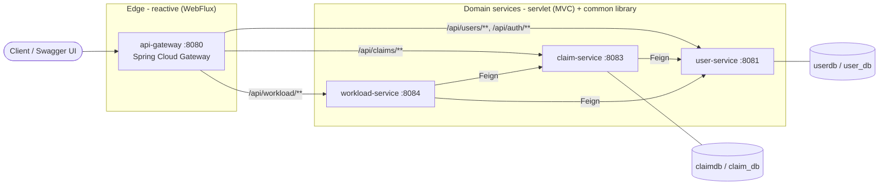
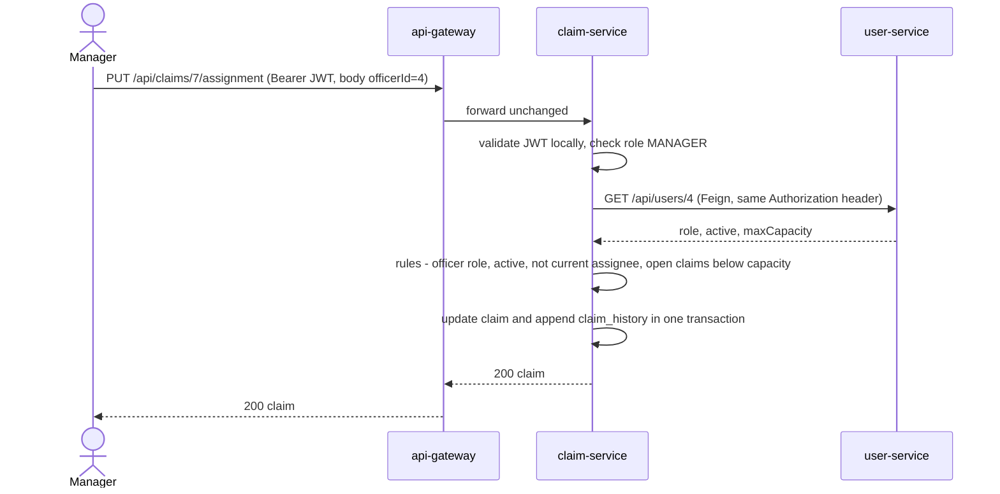
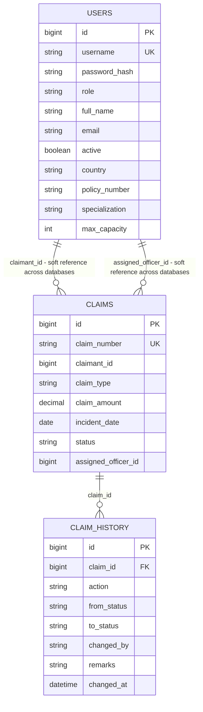
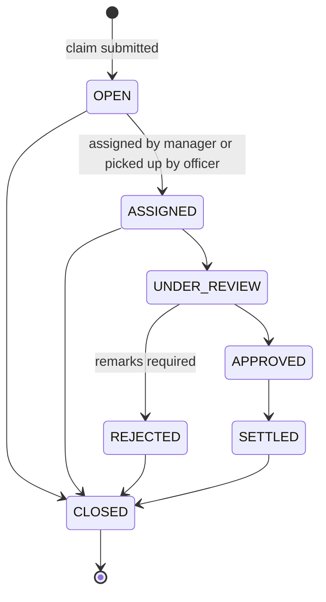

# Architecture – Chubb APAC Claims Management System

How the system is put together and why. For setup, demo users and an API walkthrough see [README.md](README.md); for the
rules to follow when changing code see [CLAUDE.md](CLAUDE.md).

Diagrams use [Mermaid](https://mermaid.js.org/), which GitHub renders inline.

## 1. Overview

A small microservice system for filing, assigning and tracking insurance claims. Four deployable Spring Boot
applications share one Maven build and one library:

* Java 21, Spring Boot 3.3.5, Spring Cloud 2023.0.3 (Gateway, OpenFeign), Spring Security (JWT resource server),
  Spring Data JPA, springdoc-openapi 2.6.0.
* **Synchronous REST only.** No message broker, no service registry, no shared database.
* **Stateless services.** Identity travels in a signed JWT; nothing is kept in an HTTP session.
* Data is in-memory H2 by default (resets on restart) and can be switched to MySQL per service.

## 2. System context



Clients only ever talk to the gateway. Service-to-service calls go directly between services (not back through the
gateway) using OpenFeign at fixed URLs.

## 3. Modules

| Module | Port | Stack | Owns | Responsibility |
|--------|------|-------|------|----------------|
| `api-gateway` | 8080 | WebFlux, Spring Cloud Gateway, springdoc webflux-ui | – | Single entry point: path routing, aggregated Swagger UI, redirects of common wrong URLs to `/swagger-ui.html`. No security, no business logic. Does **not** depend on `common`. |
| `user-service` | 8081 | MVC, JPA, `common` | `users` table | Every person in the system (claimants, officers, managers): profile, role, officer capacity, active flag. Login and JWT signing. Seeds demo users. |
| `claim-service` | 8083 | MVC, JPA, `common` | `claims`, `claim_history` | Claim submission, assignment, status workflow, audit history, per-officer open-claim counts. |
| `workload-service` | 8084 | MVC, `common` | nothing (stateless) | Utilisation per officer and next-assignee suggestion, computed live from the two services above. |
| `common` | – | plain jar | – | Shared auto-configuration: JWT validation and method security, global exception handler, Feign auth forwarding, OpenAPI bearer scheme. |

Dependencies between services, as call direction:

```
workload-service ──► claim-service ──► user-service
        └──────────────────────────────────▲
```

There are no cycles, so `user-service` can run on its own; `claim-service` needs `user-service`; `workload-service`
needs both.

### Project layout

```
claims-management-system/
├── pom.xml                 parent POM: versions, module list
├── common/                 shared auto-configuration
├── api-gateway/            application.yml holds the routes
├── user-service/           controller / service / repository / entity / dto / config
├── claim-service/          + client (Feign), model (enums, state machine), security (Caller)
├── workload-service/       + client (Feign), model (OfficerWorkload)
├── scripts/start-all.ps1   Windows build-and-launch script
└── src/Main.java           IntelliJ template file; not part of any module
```

Every service uses package-by-layer: `controller → service → repository → entity`, with `dto` records for request and
response bodies. Controllers never touch repositories.

## 4. Request flow

### 4.1 Routing

The gateway matches on path prefix and forwards the request unchanged, including the `Authorization` header:

| Path | Target |
|------|--------|
| `/api/users/**`, `/api/auth/**` | user-service |
| `/api/claims/**` | claim-service |
| `/api/workload/**` | workload-service |
| `/docs/<service>/v3/api-docs` | that service's `/v3/api-docs` (prefix stripped, `Host` header preserved so the OpenAPI "server" URL shows the gateway) |

Downstream base URLs come from `services.{user,claim,workload}.url` (env `SERVICES_USER_URL`, `SERVICES_CLAIM_URL`,
`SERVICES_WORKLOAD_URL`), defaulting to `localhost:8081 / 8083 / 8084`. The Feign clients in `claim-service` and
`workload-service` read the same `services.*.url` properties.

### 4.2 Example: a manager assigns a claim



### 4.3 Inside one service

```
HTTP ─► JWT filter ─► controller ─► service ─► repository ─► database
          │             @PreAuthorize   business rules,        Spring Data JPA
          │             @Valid          ownership checks,
          │                             @Transactional, Feign
          └─ any exception ─► GlobalExceptionHandler ─► ApiError JSON
```

## 5. Security

### 5.1 Authentication

1. `POST /api/auth/login` (the only public API endpoint) goes to `user-service`.
2. `AuthService` looks the user up, requires `active`, and checks the password against its BCrypt hash. Unknown user,
   wrong password and disabled account all return the same 401 message so usernames cannot be probed.
3. `TokenService` signs an **HS256** JWT: `iss = chubb-claims-auth`, `sub = username`, `roles = [<ROLE>]`, `iat`,
   `exp` (default 120 minutes).
4. The client sends `Authorization: Bearer <token>` on every later call.

Every servlet service validates the token **locally** with the shared secret (`chubb.security.jwt.secret`, env
`CHUBB_SECURITY_JWT_SECRET`): signature, issuer and expiry. There is no call back to `user-service` per request. Roles
in the `roles` claim become `ROLE_<name>` authorities.

### 5.2 Authorization – two layers

| Layer | Where | Examples |
|-------|-------|----------|
| Role gate | `@PreAuthorize` on controller methods (`@EnableMethodSecurity` in `common`) | assignment is `MANAGER` only; status update is `OFFICER`/`MANAGER`; workload is `OFFICER`/`MANAGER` |
| Ownership and state | service layer | a claimant sees only their own claims; officers can only update claims assigned to them (or pick up an unassigned `OPEN` one); claimants can read only their own profile |

The full endpoint-by-role table is in the README.

### 5.3 Identity propagation

* The gateway forwards the `Authorization` header untouched. It does not authenticate anything: an unauthenticated
  request is rejected by the **downstream** service, not at the edge.
* `FeignConfig` (in `common`) copies the incoming `Authorization` header onto every outgoing Feign call, so a
  downstream service enforces the **original caller's** role. There is no service-to-service credential.
* The token carries the **username, not the user id**. When `claim-service` needs the caller's id (for a claimant's own
  claims, or an officer's capacity) it calls `GET /api/users/by-username/{username}`. Claimants may read their own
  profile, so this works with the claimant's own token.

### 5.4 Public paths (every service)

`/api/auth/login`, `/swagger-ui*`, `/v3/api-docs/**`, `/actuator/health/**`, `/actuator/info`, `/h2-console/**`, plus
`OPTIONS`. CSRF is disabled (stateless bearer tokens, no cookies) and sessions are never created.

## 6. Data

### 6.1 Ownership

Each service owns its own database; nobody queries another service's tables. Cross-service references are **plain
columns**, not foreign keys or joins.



`USERS` lives in user-service's database; `CLAIMS` and `CLAIM_HISTORY` in claim-service's. Only the last relationship
is a real foreign key.

* **One `users` table for all roles.** The role decides which profile columns apply: claimants use `country` and
  `policy_number`; officers use `specialization` and `max_capacity`. Create and update enforce the mandatory fields per
  role.
* **Claim numbers** have the form `CLM-<year>-<id padded to 6>` (for example `CLM-2026-000042`). The row is first saved
  with a temporary number, then renamed once the generated id exists, in the same transaction.
* **`claim_history` is append-only.** Its columns are `updatable = false`. One row is written for every creation,
  assignment, reassignment and status change, recording who (`changed_by` = username), when, and from → to.

### 6.2 Persistence setup

| | Default | `--spring.profiles.active=mysql` |
|---|---------|----------------------------------|
| Database | in-memory H2 in MySQL mode: `jdbc:h2:mem:userdb`, `jdbc:h2:mem:claimdb` | `user_db`, `claim_db` on `localhost:3306`, created on demand |
| Override | – | `DB_URL`, `DB_USERNAME`, `DB_PASSWORD` (defaults `root` / `root`) |
| H2 console | enabled on 8081 and 8083 at `/h2-console` | disabled |
| Schema | `spring.jpa.hibernate.ddl-auto=update`, generated from the entities | same |
| Seed data | `DemoDataSeeder` in user-service when the users table is empty (`chubb.seed-demo-users`) | same |

Entities stay portable between H2-in-MySQL-mode and MySQL: no vendor-specific types or queries. `workload-service` has
no database at all.

## 7. Claim lifecycle

The only legal moves are defined once, in `ClaimStatus.canTransitionTo`.



Rules enforced in `ClaimService`:

* **Submit.** A claimant files for themselves (id taken from their token). Officers and managers must give a `claimantId`,
  which must belong to a `CLAIMANT`. New claims start `OPEN`.
* **Assign / reassign** (manager only). Allowed while the claim is `OPEN`, `ASSIGNED` or `UNDER_REVIEW`. The target must
  be an **active `OFFICER`** user, not already the assignee, with `open claims < maxCapacity`. Status moves `OPEN →
  ASSIGNED`; reassigning keeps the current status.
* **Status change** (officer or manager). `ASSIGNED` cannot be set through the status endpoint, only by assignment. Officers
  may update a claim assigned to them, or pick up an unassigned `OPEN` claim (self-assigns, capacity-checked, writes an
  `ASSIGNED` history row first). A claim assigned to a different officer returns 403 "Claim is not assigned to
  you". Managers may update any claim. `REJECTED` requires `remarks`.
* **Illegal moves** return 409 listing the allowed next statuses.

"In progress" (`ClaimStatus.IN_PROGRESS` = `ASSIGNED` + `UNDER_REVIEW`) is the single definition of "open" used for both
the capacity check and the workload numbers.

## 8. Workload calculation

`workload-service` holds no data. For each request it makes two calls:

1. `user-service` `GET /api/users?role=OFFICER&active=true` – who is eligible and each person's `maxCapacity`.
2. `claim-service` `GET /api/claims/stats/open-by-officer` – map of officer id → in-progress claim count.

Per officer: `utilization % = open / maxCapacity × 100` (one decimal, half-up; 100 if `maxCapacity ≤ 0`) and
`available = max(0, maxCapacity − open)`.

| Level | Utilisation |
|-------|-------------|
| `LOW` | below 50 % |
| `MODERATE` | 50 % to below 80 % |
| `HIGH` | 80 % to below 100 % |
| `FULL` | 100 % or more |

The list is sorted least utilised first (ties by id). The suggestion is the first entry with spare capacity; if there
is none the call returns 409.

## 9. Cross-cutting concerns (`common`)

`common` is a plain jar. `META-INF/spring/org.springframework.boot.autoconfigure.AutoConfiguration.imports` registers
`CommonAutoConfiguration`, which imports four configurations, so any servlet service gets them just by depending on
the jar:

| Config | Provides |
|--------|----------|
| `SecurityConfig` | Stateless filter chain, JWT decoder (HS256 + issuer check), role-claim → authority mapping, JSON 401 entry point, `@EnableMethodSecurity` |
| `GlobalExceptionHandler` | The only place exceptions become HTTP responses (`ApiError`) |
| `FeignConfig` | `Authorization` header forwarding; downstream 404 → `ResourceNotFoundException` |
| `OpenApiConfig` | OpenAPI title plus a bearer-JWT scheme so Swagger's **Authorize** works |

The gateway is reactive and cannot use the servlet-based `SecurityConfig`, which is why it does not depend on `common`.

### Error model

One JSON shape everywhere: `timestamp`, `status`, `error`, `message`, `path`, `details[]`.

| Cause | Status |
|-------|--------|
| Bean validation failure (field errors in `details`), malformed JSON, bad parameter type | 400 |
| Bad login | 401 |
| `AccessDeniedException` (role or ownership) | 403 |
| `ResourceNotFoundException`, unknown route | 404 |
| Wrong HTTP method / media type | 405 / 415 |
| `BusinessRuleException` (illegal transition, capacity, not an officer), unique-constraint violation | 409 |
| Downstream 4xx (other than 404) is relayed; downstream 5xx or connection failure | 4xx as-is / 502 |
| Anything else | 500 (details logged, not returned) |

The 401 for a **missing or expired token** is written by the security filter before MVC is reached, so it has a slimmer
body: `status`, `error`, `message` only, with a hint to log in again.

## 10. Configuration reference

| Setting | Env var | Default | Applies to |
|---------|---------|---------|------------|
| `server.port` | – | 8080 / 8081 / 8083 / 8084 | each service |
| `chubb.security.jwt.secret` | `CHUBB_SECURITY_JWT_SECRET` | built-in demo value, min. 32 characters | user, claim, workload (**must be identical**) |
| `chubb.security.jwt.issuer` | – | `chubb-claims-auth` | same three |
| `chubb.security.jwt.expiration-minutes` | – | 120 | user-service (signs) |
| `services.user.url` | `SERVICES_USER_URL` | `http://localhost:8081` | gateway, claim, workload |
| `services.claim.url` | `SERVICES_CLAIM_URL` | `http://localhost:8083` | gateway, workload |
| `services.workload.url` | `SERVICES_WORKLOAD_URL` | `http://localhost:8084` | gateway |
| `chubb.seed-demo-users` | – | `true` | user-service |
| `spring.profiles.active` | – | none (H2) | user, claim: `mysql` |
| `DB_URL` / `DB_USERNAME` / `DB_PASSWORD` | same | per-service MySQL URL, `root` / `root` | user, claim, `mysql` profile only |

Actuator exposes only `health` and `info` on every service (`/actuator/health` on 8080, 8081, 8083, 8084).

## 11. Build, run and operations

* **Build:** `./mvnw clean install` (Maven wrapper; JDK 21 via `JAVA_HOME`). Module order is `common` first, then the
  rest. Each service becomes a Spring Boot fat jar at `<module>/target/<module>-1.0.0.jar`.
  After editing `common`, run `clean install`: the service jars are not repackaged when only a dependency changed.
* **Run:** `scripts/start-all.ps1` builds, then starts the four jars in dependency order (user, claim, workload,
  gateway), each in its own minimised window. Or run the jars by hand, or `./mvnw -pl <module> spring-boot:run`.
* **Start order is a convenience, not a requirement.** Feign clients use fixed URLs and call lazily, so a service boots
  even if its dependencies are down; calls to them fail with 502 until they are up. Log in only after `user-service` is
  up.
* **One set only.** Running jars lock their files and a double start leaves two sets of processes on the same ports:
  stop with `Get-Process java | Stop-Process -Force` before rebuilding or restarting. Where `java` on `PATH` is the
  Oracle launcher stub (`...\Common Files\Oracle\Java\javapath`), each service shows as two `java` processes (stub plus
  JVM), so expect 8 for 4 services.
* **Logs:** console output; when started hidden with redirected output, `%TEMP%\cms-logs\<service>.out.log` and
  `.err.log`.
* **API docs:** the gateway's Swagger UI at `http://localhost:8080/swagger-ui.html` aggregates the three services;
  each service also serves its own at `/swagger-ui.html`.

## 12. Testing

JUnit 5, Mockito and AssertJ; run with the build.

| Module | Tests |
|--------|-------|
| `claim-service` | `ClaimStatusTest` (state machine), `ClaimServiceTest` (rules, Mockito), `ClaimRepositoryTest` (JPA on H2) |
| `user-service` | `UserServiceTest`, `AuthServiceTest`, `UserRepositoryTest`, `UserControllerTest` (controller security and validation), `AuthFlowIntegrationTest` (real login, real token, real filter chain) |
| `workload-service` | `WorkloadServiceTest` |
| `common`, `api-gateway` | none |

`claim-service` and `workload-service` have no controller-level tests.

## 13. Design decisions and trade-offs

| Decision | Benefit | Cost |
|----------|---------|------|
| **Database per service**, soft references by id | Services can change and scale independently; no shared-schema coupling | No foreign keys across services; id lookups need a Feign call; see 14.2 |
| **One user service for all roles** | One login, one identity, one place for roles and capacity; claim and workload read officer data from the same source | The `users` table has role-specific nullable columns |
| **Stateless JWT, validated locally** | No per-request call to the auth service; any service can authorise on its own | No revocation or refresh tokens; a token is valid until it expires; every service needs the same secret |
| **Gateway routes but does not authenticate** | Gateway stays thin; each service stays safe even if reached directly | A bad request travels one hop before it is rejected; auth rules exist only in the services |
| **Fixed service URLs, no registry (Eureka)** | Four processes and no extra infrastructure; trivial to run locally | No load balancing or dynamic discovery; each URL is configured by hand per environment |
| **Caller's token forwarded on Feign calls** | Original role enforced end to end; no service accounts to manage | A service can only do what the end user may do; background or system-initiated calls would need a different mechanism |
| **Shared `common` library as auto-configuration** | One place for security, errors and OpenAPI; services add nothing to adopt it | Changes to `common` require rebuilding every service |
| **Workload computed live** | Always consistent with the claims; nothing to keep in sync | Two synchronous calls per request; no caching |

## 14. Known limitations

Fine for a local demo; address before production.

### 14.1 Security

* The default JWT secret is in the source. Set `CHUBB_SECURITY_JWT_SECRET` (same value in user, claim and workload).
* `/h2-console/**` is on the public path list of every service and the H2 console is enabled by default. Disable both
  outside local use (the `mysql` profile turns the console off, but the path stays permitted).
* No token revocation, refresh tokens or self-service password change.
* The gateway has no rate limiting or CORS configuration.
* Demo credentials are seeded on first start; set `chubb.seed-demo-users=false` in production.

### 14.2 Data and consistency

* **Capacity check is not atomic.** `assign` and officer pick-up count open claims, then save, with no row lock or
  `@Version`. Two concurrent assignments to an officer one claim below capacity can both succeed and exceed it.
* **No referential integrity across services.** Deleting a user does not check or update claims that reference
  them (`claimant_id`, `assigned_officer_id`), and claims are not cascaded.
* **No schema migrations.** Tables come from `ddl-auto=update`; there is no Flyway or Liquibase. This matters after
  the *staff → officer* rename: the in-memory H2 default is unaffected, but an existing MySQL database keeps the old
  `role = 'STAFF'` values (which no longer map to the `Role` enum) and gains an empty `assigned_officer_id` column
  next to the old one. Migrate once, before starting the new build:

  ```sql
  -- user_db
  UPDATE users SET role = 'OFFICER' WHERE role = 'STAFF';
  -- claim_db
  ALTER TABLE claims CHANGE assigned_staff_id assigned_officer_id BIGINT;
  ```
* **Shared `DB_URL`.** `user-service` and `claim-service` read the same variable names for the `mysql` profile. If you
  set `DB_URL` globally, both services point at the same database and database-per-service is lost; set it per
  process.

### 14.3 Resilience and operations

* No retries, circuit breakers or bulkheads, and no explicit Feign timeouts (Feign defaults apply). A slow `user-service`
  slows every service that calls it, and `workload-service` fails as a whole if either dependency fails.
* No distributed tracing, metrics beyond actuator health/info, or centralised logging.
* Each service is a single instance; the gateway has no load balancing.

### 14.4 Where this is likely to grow

* Replace fixed URLs with a registry or platform service discovery, and move the gateway route targets to `lb://`.
* Replace the shared HS256 secret with an identity provider and asymmetric (RS256/JWKS) validation.
* Add `@Version` (optimistic locking) on `Claim`, or a database-level capacity guard.
* Publish claim events (assigned, status changed) so workload can be pushed or cached rather than recomputed.
